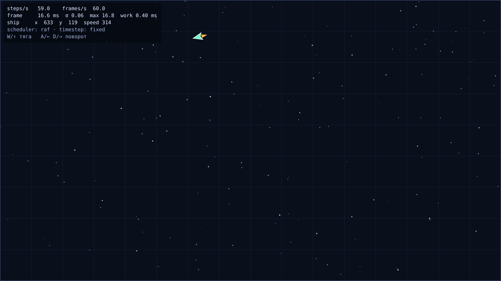
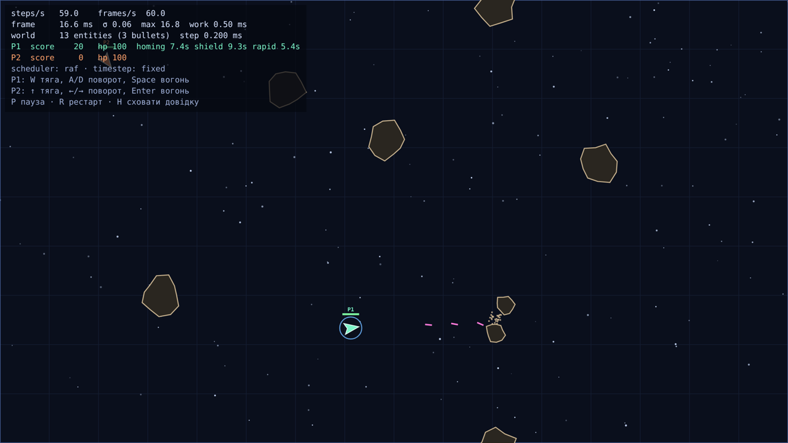

# Dogfight

Двовимірна арена, де кораблі літають, стріляють і ухиляються в реальному часі. Гра росте лаба за лабою в курсі
[JavaScript — Build a Multiplayer Browser Game](https://github.com/rmalkevy/Programming-Practice-Projects/blob/main/courses/javascript/README.md).
Тема — космічні кораблі над зоряною сіткою.

| Лаба | Тег      | Що додано                                                                                                                                                |
| ---- | -------- | -------------------------------------------------------------------------------------------------------------------------------------------------------- |
| 1    | `lab-01` | Ігровий цикл з фіксованим кроком, корабель під керуванням з клавіатури, HUD, 3 експерименти                                                              |
| 2    | `lab-02` | Модель сутностей (`class` + один `extends`), світ на `Map`, кулі, астероїди, колізії, урон, респаун, рахунок, самонавідні кулі й бонуси через композицію |

## Запуск

```bash
nvm use            # Node 22 з .nvmrc (на Windows: nvm-windows або fnm)
npm install
npm run dev        # http://localhost:5173
npm test           # тести симуляції (node:test, без браузера)
npm run lint       # ESLint (flat config)
npm run format     # Prettier
npm run build      # продакшн-збірка у dist/
```

Керування (два гравці за однією клавіатурою):

| Дія     | P1 (бірюзовий) | P2 (помаранчевий) |
| ------- | -------------- | ----------------- |
| Тяга    | W              | ↑                 |
| Поворот | A / D          | ← / →             |
| Вогонь  | Space          | Enter             |

**P** — пауза, **R** — рестарт, **H** — сховати довідку. Параметри URL: `?players=1` (гра вдвох вимкнена),
`?seed=42` (інше зерно світу), `?bug=this` (демонстрація бага з `this`), а також перемикачі експериментів Lab 1
(див. `src/experiments.js`).

## Структура

```
index.html              <canvas> + <script type="module" src="/src/main.js">
src/
  main.js               збирає модулі докупи й запускає цикл (логіки гри тут немає)
  loop.js               createAccumulator() + createLoop({ step, simulate, render }) — rAF і фіксований крок
  input.js              createInput(target) — замикання над станом клавіш; readControls()
  experiments.js        перемикачі експериментів M4 через параметри URL
  sim/                  симуляція: БЕЗ DOM і canvas (ESLint забороняє браузерні глобали в цій теці)
    math.js             lerp, wrapAngle, lerpAngle
    arena.js            розміри арени, обгортання країв (тор), wrappedDelta
    vector.js           Vector2: чисті методи + *InPlace для гарячого шляху            (Lab 2)
    rng.js              детермінований генератор випадкових чисел (mulberry32)        (Lab 2)
    entity.js           class Entity: #id зі статичного лічильника, pos/vel/angle/radius (Lab 2)
    ship.js             class Ship extends Entity, integrate(), #hp, fire(), ефекти    (Lab 1→2)
    bullet.js           class Bullet extends Entity (TTL)                              (Lab 2)
    asteroid.js         class Asteroid extends Entity (big/small, seeker)              (Lab 2)
    pickup.js           class Pickup extends Entity + таблиця PICKUP_TYPES             (Lab 2)
    explosion.js        class Explosion extends Entity (частинки)                      (Lab 2)
    behaviors.js        компоненти поведінки: homing(), timeToLive(), spin()           (Lab 2)
    collision.js        findCollisionsNaive(entities, arena) → пари                    (Lab 2)
    rules.js            що означає зіткнення: таблиця обробників за парою kind         (Lab 2)
    world.js            class World: Map<id, Entity>, step(), ofKind(), відкладений despawn (Lab 2)
  render/
    canvas.js           canvas з урахуванням DPR, зміна розміру, камера
    draw.js             фон, кораблі, кулі, астероїди, бонуси, вибухи, HUD (вибір за kind)
test/lab01.test.js      детермінізм, незалежність від частоти кадрів, обмеження кроку, lerpAngle
test/lab02.test.js      Vector2, ієрархія в один рівень, #hp, баг з this, World, колізії, композиція
scripts/bench-vector.js мікробенчмарк: чисті vs in-place операції з векторами
```

---

## Lab 1 — Цикл подій як ігровий цикл

### Що зроблено

- **M1 — цикл.** `createLoop` викликає `requestAnimationFrame` і використовує акумулятор з обмеженням
  (`maxFrame = 0.25 s`). Симуляція йде рівно 60 кроків на секунду, рендер — раз на кадр дисплея. Цикл
  публікує `stepsPerSec`, `framesPerSec`, `frameTime` (інтервал між кадрами), `frameWork` (час нашого коду в кадрі),
  `jitter` (σ інтервалу за останні 120 кадрів) і `maxFrameTime`. Усе це видно в HUD.
- **M2 — ввід і корабель.** `createInput(window)` — це замикання над двома приватними `Set`: `down` (клавіші,
  затиснуті зараз) і `pressed` (фронти натискання від попереднього кроку симуляції). `justPressed` очищується в
  `endStep()` **після кожного кроку симуляції**, а не після кадру. Причина: на 144 Гц бувають кадри без жодного
  кроку, а на 30 Гц — кадри з двома, тож очищення раз на кадр губило б або дублювало натискання. На `blur` стан
  скидається, бо `keyup` поза фокусом не надходить. Корабель — звичайний об'єкт `{ x, y, vx, vy, angle, thrust }`, а
  `integrate(ship, controls, dt)` залежить лише від своїх аргументів. Симуляція бачить не клавіші, а
  `controls` — звичайні дані.
- **M3 — рендер з інтерполяцією.** Зберігаються стани `previous` і `current`. Рендер малює
  `lerp(previous, current, alpha)`, а кут інтерполюється найкоротшою дугою (`lerpAngle`). Позиція інтерполюється
  через `wrappedDelta`, щоб на межі арени корабель не «пролітав» через усе поле за один кадр. Біля краю
  `drawWrapped` малює ще й копію з протилежного боку, і корабель плавно перетинає межу. Canvas враховує
  `devicePixelRatio` і перемальовується при зміні розміру вікна та при перенесенні вікна на інший монітор
  (`matchMedia('(resolution: …dppx)')`). Арена має фіксований логічний розмір 1600×900, а камера
  вписує її у вікно. Тому розмір вікна на симуляцію не впливає.
- **M4 — три експерименти** (нижче), кожен вмикається параметром URL і не потребує змін у коді.



### Тюнінг керування

| Параметр   | Значення  | Чому так                                                                                                                                                          |
| ---------- | --------- | ----------------------------------------------------------------------------------------------------------------------------------------------------------------- |
| `turnRate` | 3.4 рад/с | Почав з 5 — корабель «крутився дзиґою», і прицілитись було неможливо. 3.4 дає повний оберт за ~1.85 с                                                             |
| `thrust`   | 380 од/с² | 200 було ватно; 380 — розгін до 300 од/с менше ніж за секунду                                                                                                     |
| `drag`     | 0.55 1/с  | Експоненційне згасання `v *= exp(-k·dt)` — точний розв'язок, однаковий для будь-якого `dt`. Після відпускання тяги корабель котиться ~2 с, і відчувається інерція |
| `maxSpeed` | 460 од/с  | Арену шириною 1600 корабель перетинає за ~3.5 с: досить швидко, але око встигає стежити                                                                           |

Інтегратор — напівнеявний Ейлер: спочатку швидкість, потім позиція. Він стабільніший за явний і для
гри цілком достатній.

### Експерименти (M4)

Виміри зроблено в Chromium 141 (Playwright), вікно 1280×720, дисплей 60 Гц, по 10 с на кожен режим.
Автоматичний скрипт читав `window.__dogfight.stats` щокадру. Повторити вручну:
`npm run dev`, відкрити посилання з таблиці й дивитися HUD.

#### 1. Синхронне блокування 100 мс кожен 60-й кадр — `/?block=100`

| Метрика                              | Норма (`/`) |      З блокуванням |
| ------------------------------------ | ----------: | -----------------: |
| frames/s                             |        60.0 |           **55.4** |
| steps/s                              |        60.0 |               60.0 |
| інтервал кадру, медіана              |     16.7 мс |            16.7 мс |
| інтервал кадру, p99 / max            | 16.8 / 16.8 | **100 / 100.1** мс |
| σ інтервалу                          |     0.06 мс |            10.5 мс |
| кроків симуляції в кадрі після блоку |           1 |              **6** |

**Що бачить гравець:** раз на секунду гра «спотикається». Картинка застигає на 100 мс, а потім корабель
стрибком опиняється далі, бо акумулятор доганяє 6 пропущених кроків в одному кадрі. Середня кількість кроків
лишається 60/с, тож фізика не сповільнюється, але плавність зникає.

**Чому це не обійти з того самого потоку.** JavaScript виконує задачу до кінця (run-to-completion). Поки
`while` крутиться на стеку викликів, цикл подій стоїть: він бере наступну задачу лише тоді, коли стек порожній. У цей час
не виконуються ні колбеки `setTimeout`, ні обробники клавіш, ні мікрозадачі, ні наступний `requestAnimationFrame`,
і браузер не може навіть намалювати кадр, бо рендеринг — теж крок того самого циклу. Будь-який «обхід»
(таймер, проміс, ще один rAF) — це лише інша черга, яку обслуговує той самий заблокований потік. Допомогти можна
тільки ззовні: розбити роботу на шматки між кадрами або винести її в Web Worker (окремий потік).

#### 2. `setInterval(frame, 16)` замість rAF — `/?sched=interval`

| Метрика                   |     rAF |  setInterval(16) |
| ------------------------- | ------: | ---------------: |
| frames/s                  |    60.0 |         **62.5** |
| steps/s                   |    60.0 |             60.0 |
| σ інтервалу (вимір циклу) | 0.06 мс | **0.21–0.31 мс** |
| max інтервал за 10 с      | 16.8 мс |          19.2 мс |

**Що відрізняється.** 1000 / 16 = 62.5 виклику на секунду, а дисплей показує 60 кадрів. Отже ~2.5 рендери на
секунду не потрапляють на екран: це марна робота, а в ці моменти на один кадр дисплея припадає два наші
рендери, і рух ледь помітно смикається. Таймер не прив'язаний до vsync: інтервал «плаває» в 4–5 разів сильніше,
ніж у rAF, а 16 ≠ 16.667. Фізика при цьому залишилась на 60 кроках завдяки фіксованому кроку.

**Фонова вкладка.** У звичайному Chrome/Edge rAF у прихованій вкладці не викликається взагалі, і гра стоїть на
паузі. Після повернення перший інтервал великий, але акумулятор обрізає його до 0.25 с (15 кроків), тож корабель
не «телепортується». `setInterval` у фоні продовжує працювати, але браузер приглушує його до ≤ 1 разу на
секунду (а після 5 хв — ще сильніше): гра «живе» ривками й витрачає батарею на кадри, яких ніхто не бачить.
_В автоматизованому браузері вкладка не стає `hidden` (Playwright вимикає фонове приглушення), тому цей пункт
треба перевірити руками: перемкнути вкладку на 5 с, повернутись і подивитись на `max` у HUD._

#### 3. Змінний крок замість акумулятора + CPU throttling 6× — `/?timestep=variable&autopilot=1`

Автопілот тримає «тягу» з моменту t = 0 і записує позицію, щойно час симуляції досягне 5 с. Для 6× використано
`Emulation.setCPUThrottlingRate` (це той самий механізм, що й у DevTools → Performance → CPU 6× slowdown) і
додаткове навантаження 4 мс/кадр, щоб частота кадрів реально впала.

| Режим                   | CPU | frames/s | кроків | t, с     | y через 5 с            |
| ----------------------- | --- | -------: | -----: | -------- | ---------------------- |
| фіксований крок         | 1×  |     60.0 |    300 | 5.000000 | **324.89891456786995** |
| фіксований крок         | 6×  |     36.4 |    300 | 5.000000 | **324.89891456786995** |
| фіксований крок, повтор | 1×  |     60.0 |    300 | 5.000000 | **324.89891456786995** |
| змінний крок            | 1×  |     60.0 |    301 | 5.016400 | 317.35495682019860     |
| змінний крок            | 6×  |     36.8 |    183 | 5.016500 | 314.61716408321763     |
| змінний крок, повтор    | 1×  |     60.0 |    302 | 5.016400 | 317.35503653894330     |

- **Фіксований крок:** три запуски, дві різні частоти кадрів — позиція збігається до останнього біта.
- **Змінний крок:** розходиться навіть між двома запусками на _тій самій_ машині (різниця 8·10⁻⁵, бо інтервали
  кадрів трохи плавають), а між 1× і 6× — на 2.7 одиниці. Причин дві: (1) неможливо навіть зупинитись рівно на
  5 с — останній кадр «перестрибує» позначку; (2) інтеграція з `dt` ≈ 27 мс дає іншу похибку, ніж з 16.7 мс.
  Для мультиплеєра (Lab 5) це смертельно: сервер і клієнт мають отримувати однаковий стан з однакових входів.

Ті самі властивості зафіксовано тестами (`npm test`, файл `test/lab01.test.js`): 60/144/30 Гц з джитером дають
однаковий стан після 300 кроків, а змінний крок — різний.

### Що я зрозумів

- Цикл подій — це «коли стек порожній, взяти наступне з черги». Усе асинхронне — це API хоста, яке ставить
  колбек у чергу, а не викликає його.
- Мікрозадачі вичерпуються повністю після кожної задачі, тому нескінченний ланцюжок мікрозадач блокує рендер так
  само, як `while(true)`.
- rAF — окремий крок рендерингу. Він синхронізований з дисплеєм і ставиться на паузу у фоні, тому для анімації
  це правильний інструмент.
- Фіксований крок + інтерполяція дають детермінізм і плавність одночасно. Обмеження `maxFrame` рятує від
  «спіралі смерті».
- Замикання — найкоротший шлях до приватного стану без класів (`createInput`).

---

## Lab 2 — Об'єкти, прототипи і `this`: модель сутностей



### Що зроблено

- **M1 — `Vector2` і базовий `Entity`.** `Vector2` має чисті методи (`add`, `sub`, `scale`, `length`,
  `normalize`, `rotate`, `dot`, `static fromAngle`), які завжди повертають новий вектор, і окремі
  `addScaledInPlace` / `scaleInPlace` / `copy` / `set` для гарячого шляху (потреба виміряна, див. нижче).
  `Entity` має `id` (геттер над приватним `#id`, який видає приватний статичний `static #nextId`), `kind`, `pos`,
  `vel`, `angle`, `radius`, `alive`, `update(dt)`, а також `prevPos`/`prevAngle` для інтерполяції. Корабель з
  Lab 1 став `class Ship extends Entity`: рівно один рівень. `integrate()` з Lab 1 лишився чистою функцією і тепер
  працює з полями `Vector2`.
- **M2 — світ на `Map`.** `World` тримає `#entities: Map<number, Entity>`. Є `spawn`, `despawn(id)`
  (відкладене: позначити мертвим, прибрати в кінці кроку), `get`, `[Symbol.iterator]` (генератор над
  `values()`) і `*ofKind(kind)` — лінивий фільтр без проміжного масиву. Порядок `step(dt, inputs)`: зберегти
  попередні стани → роздати керування кораблям і відрахувати респаун → `update` + поведінки + обгортання країв →
  колізії → «прибирання» мертвих → спавнери → додати відкладені сутності. Нові сутності, створені посеред кроку,
  чекають у черзі `#pending`: ітератор `Map` _відвідує_ елементи, додані під час обходу, тож куля, випущена
  під час оновлення, без черги зрушила б ще в тому самому кроці. Є `Bullet` (TTL 1.1 с), `Asteroid` (дрейфують,
  відскакують один від одного й від кораблів), `Ship.fire()` з успадкованою швидкістю
  (`vel = ship.vel + напрям · 640`).
- **M3 — колізії, урон, респаун.** `collision.js` — окрема система: `findCollisionsNaive(world, arena)` повертає
  масив пар `[a, b]` і нічого не вирішує. Наївний O(n²), з урахуванням тора. Система підставляється через
  `new World({ findCollisions })`, тож у Lab 7 її можна замінити на просторовий хеш. Наслідки описано в
  `rules.js` таблицею обробників за парою `kind`. Кулі шкодять кораблям (крім свого) і астероїдам. Великий
  астероїд розколюється на два малих. У кораблів приватний `#hp` з публічним `get hp()`, і змінити його можна
  лише через `damage()`. Знищений корабель породжує `Explosion` (40 частинок) і через 2 с з'являється знову в
  «безпечному» місці (40 випадкових спроб, найдальше від усього, що стикається) з 2 с невразливості. Рахунок
  у HUD: +100 за корабель, +20 за великий астероїд, +10 за малий.
- **M4 — композиція.** Самонавідна поведінка `homing()` чіпляється і до кулі (бонус **H**), і до астероїда
  («seeker», червоний контур, ~25 % нових великих астероїдів). Бонуси **S** (щит), **R** (швидкострільність),
  **H** (самонавідні кулі) — це одна сутність `Pickup` + таблиця даних `PICKUP_TYPES`, а на кораблі — `Map`
  активних ефектів. Обґрунтування нижче.

Вся симуляція детермінована: випадковість іде лише з `world.rng` (mulberry32 із зерном), а тест
`determinism: same seed + same inputs -> same world` проганяє 600 кроків двічі й порівнює стан.

### Баг з `this` і як я його виправив

Корабель стріляє з симуляції (`this.fire(world)` усередині `Ship.update` — неявне прив'язування, `this` =
корабель). Але для UI-дій у модулі вводу з'явився подієвий API `input.onPress(code, callback)`, і перша спроба
повісити постріл на клавішу F виглядала так:

```js
input.onPress("KeyF", ship.fire);
```

Натискання F → `TypeError: Cannot read properties of undefined (reading 'angle')`. Причина: передано _функцію_, а
не виклик. Модуль вводу викликає її як `callback(e)`, тобто «голим» викликом. Це правило за замовчуванням, а в
модулях і класах завжди strict mode, тож `this === undefined`. Баг відтворюється з `?bug=this` (натиснути F і
подивитися консоль), а тест `the this bug: a detached method loses its receiver` фіксує і саму помилку, і
три виправлення.

| Виправлення                             | Плюс                                                        | Мінус                                                                                           |
| --------------------------------------- | ----------------------------------------------------------- | ----------------------------------------------------------------------------------------------- |
| `() => ship.fire(world)` — **обрано**   | Видно, на чому і з чим викликається; можна передати `world` | Нова функція на кожну підписку; для відписки треба зберегти посилання                           |
| `ship.fire.bind(ship, world)`           | Явно; `this` зафіксовано назавжди                           | Знову нова функція; `bind` легко забути там, де він потрібен                                    |
| `fire = (world) => { … }` як поле класу | Метод уже прив'язаний, передавати можна як завгодно         | Окрема функція на **кожен** екземпляр (не в прототипі) — більше пам'яті; не працює `super.fire` |

Обрано стрілку-обгортку: UI-дії (`P`, `R`, `H`) підписані саме так. Окреме спостереження: API модуля вводу з
Lab 1 (`isDown`, `justPressed`) побудовано на замиканні, а не на `this`, тому `codes.some(input.isDown)`
працює і без прив'язування. Те саме видно у фільтрі самонавідної кулі всередині `Ship.fire`:
`(target) => target.playerId !== this.playerId`. Стрілка бере `this` лексично, тож це корабель, хоча
викликатиме функцію зовсім інший код.

### Чому композиція, а не глибоке дерево `extends`

Як виглядала б ієрархія:

```
Entity
 ├─ MovingEntity
 │   ├─ Bullet
 │   │   └─ HomingBullet            ← homing №1
 │   ├─ Asteroid
 │   │   └─ HomingAsteroid          ← homing №2, той самий код ще раз
 │   └─ Ship
 │       └─ PlayerShip
 │           ├─ ShieldedPlayerShip   ← а щит + швидкострільність одночасно?
 │           └─ RapidFirePlayerShip
 └─ StaticEntity
     └─ Pickup
         ├─ ShieldPickup
         ├─ RapidPickup
         └─ HomingPickup
```

Проблеми видно одразу. Логіку самонаведення треба або дублювати у двох гілках, або піднімати в `MovingEntity`,
де вона не потрібна більшості нащадків. Комбінації ефектів (щит **і** швидкострільність) ієрархія не
виражає взагалі. А ефект, що з'являється й зникає під час гри, неможливий, бо клас об'єкта після `new` не
змінюється. Кожен новий бонус — це новий клас.

Що зроблено натомість (поєднання трьох прийомів з теорії, розділ 3):

1. **Поведінка як компонент.** `homing()`, `timeToLive()`, `spin()` — фабрики, що повертають
   `{ name, update(entity, dt, world) }`, а налаштування живуть у замиканні. Сутність має масив `behaviors`, і світ
   після `update` викликає кожну поведінку. `bullet.with(homing(...))` і `asteroid.with(homing(...))` — один
   і той самий код. TTL у куль, бонусів і вибухів — теж один компонент.
2. **Поведінка як дані.** Типи бонусів — рядки таблиці `PICKUP_TYPES` (тривалість, підпис, колір), а ефекти на
   кораблі — `Map<назва, секунди>`. Ефекти комбінуються, мають таймери й зникають, і для цього не потрібен
   жоден клас. До того ж це легко серіалізувати, що знадобиться в Lab 5.
3. **Правила як таблиця.** Що станеться при зіткненні, вирішує `rules.js` за ключем `"asteroid|bullet"`,
   `"bullet|ship"`… Новий тип сутності додає рядки, а не перевизначення `onCollide` у п'яти класах.

`extends` лишився там, де він чесний: «корабель **є** сутністю» і ділить з нею `id`, `pos`, `update`. Перевірка в
тестах: `Object.getPrototypeOf(X.prototype) === Entity.prototype` для всіх п'яти класів, і жодного глибшого рівня.
Малювання теж відокремлене: `draw.js` вибирає функцію за `kind`, тому класи симуляції не знають про canvas
і без змін запустяться на сервері в Lab 4–5.

### Виміри

**Чисті vs in-place вектори** (`node scripts/bench-vector.js`, Node 22, 5000 тіл, 600 кроків, медіана 7 прогонів):

| Варіант                              | Час на крок | Алокацій на крок |
| ------------------------------------ | ----------: | ---------------: |
| `b.pos = b.pos.add(b.vel.scale(dt))` |    140.9 µs |           10 000 |
| `b.pos.addScaledInPlace(b.vel, dt)`  |     25.2 µs |                0 |

In-place варіант у 5.6 раза швидший і не створює сміття для GC. Тому інтеграція (`Entity.update`,
`integrate`) використовує in-place методи, а решта коду — чисті, бо там читабельність важливіша.

**Наївні колізії O(n²)** — `World.step` з N малими астероїдами (Node 22, середнє за 120 кроків):

| N астероїдів |      50 |     200 |    1000 |    2000 |
| ------------ | ------: | ------: | ------: | ------: |
| `World.step` | 0.07 мс | 0.27 мс | 8.05 мс | 31.7 мс |

Подвоєння N з 1000 до 2000 дає ×3.9 часу, тобто квадратичне зростання, як і має бути. На реальній арені (~20–40
сутностей) крок займає ~0.2 мс з бюджету 16.7 мс, тож поки що це не проблема. Число записане, щоб у Lab 7
порівняти з просторовим хешем.

### Відповіді на «поясни біля дошки»

1. **Чотири правила `this`:** `new` → явне (`call`/`apply`/`bind`) → неявне (`obj.f()`) → за замовчуванням
   (`undefined` у strict). `setTimeout(ship.fire, 100)` викликає функцію «голою» → `this` = `undefined`
   (у модулі). Виправлення: стрілка (нова функція на виклик), `bind` (легко забути, нова функція), поле-стрілка
   (пам'ять на кожен екземпляр, немає в прототипі).
2. **Стрілки ігнорують `bind`,** бо не мають власного `this`: вони беруть його з лексичного оточення, як звичайну
   змінну із замикання. Вони добрі для колбеків, але погані як спільний метод тисячі куль, бо кожен екземпляр
   отримує свою копію замість однієї в прототипі.
3. **`Map` замість `{}`:** ключі зберігають тип (`1` ≠ `"1"`), є `.size` і гарантований порядок вставки, немає
   успадкованих ключів (`obj["constructor"]`), а часті додавання/видалення працюють швидше.
4. **Композиція замість наслідування:** див. діаграму вище. `homing` один і чіпляється до будь-чого.
