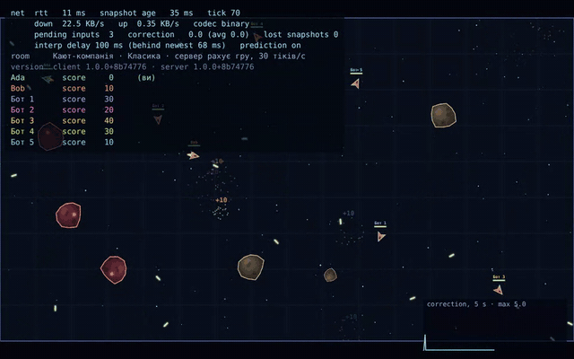
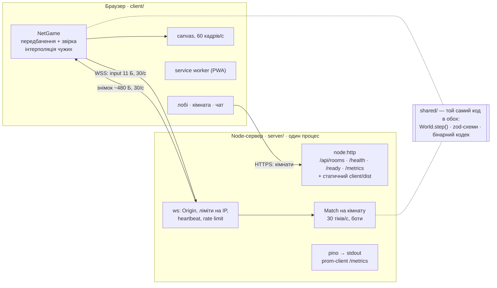
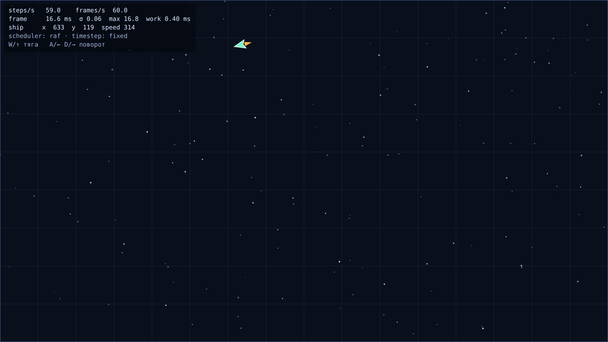
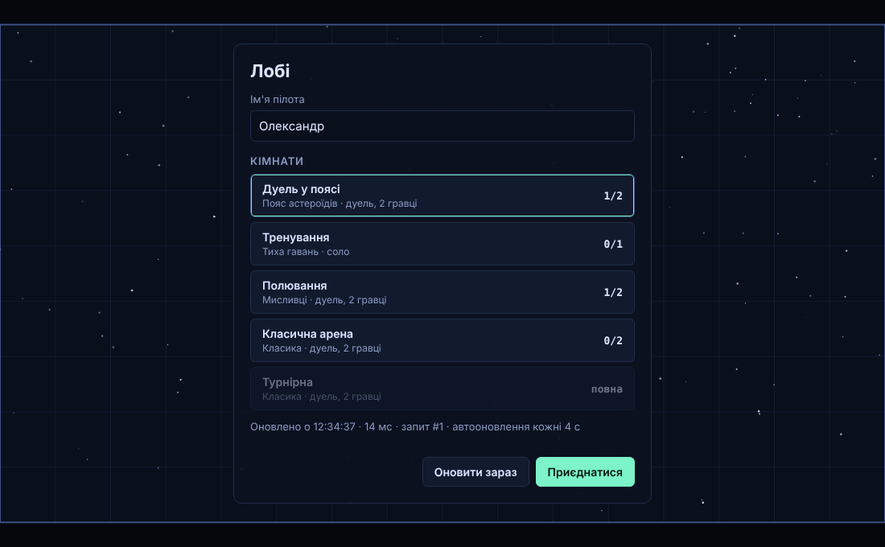
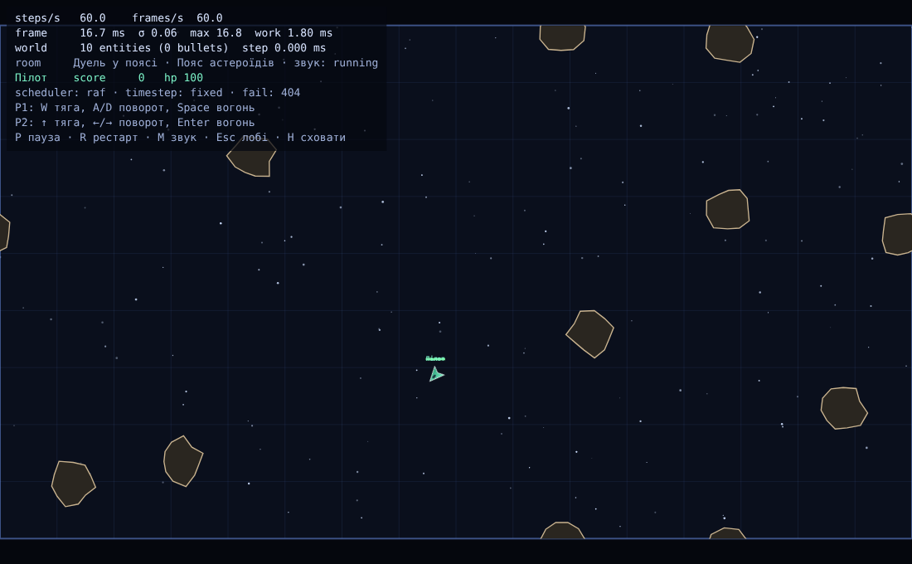
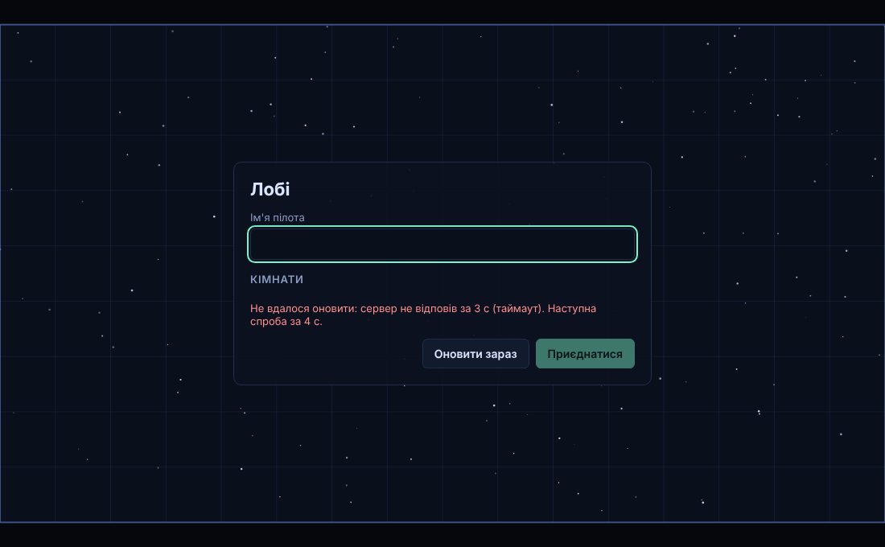
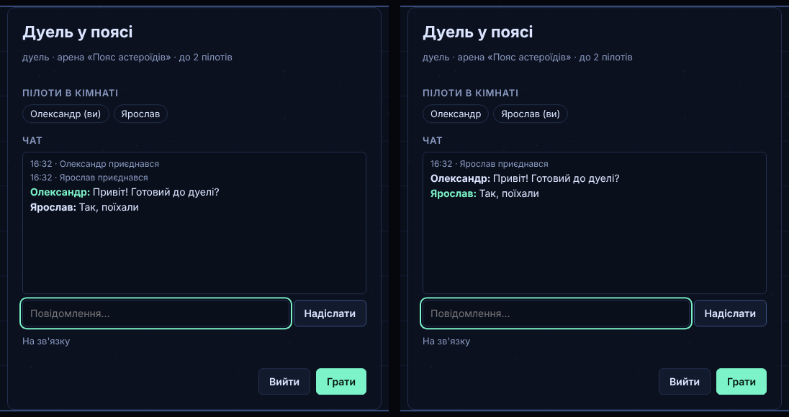
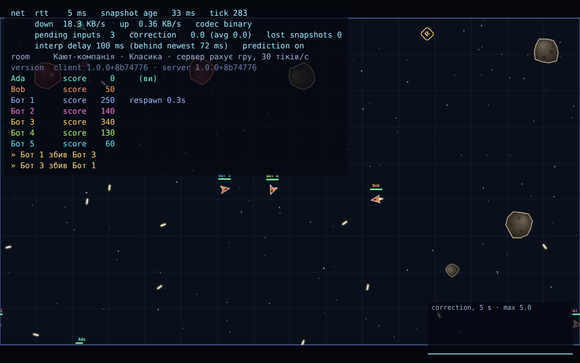
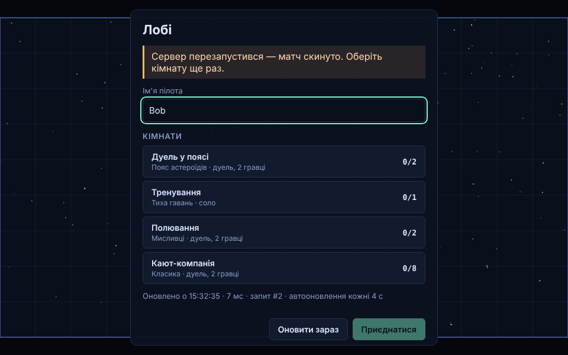

# Dogfight

[](https://github.com/bakugan1-os/dogfight/actions/workflows/ci.yml)

**Космічні дуелі в браузері для 1–8 пілотів.** Сервер рахує гру 30 разів на секунду, браузер лише надсилає
натискання клавіш і малює. Свій корабель реагує одразу (передбачення), чужі рухаються плавно (інтерполяція).
Гру можна встановити на телефон чи комп'ютер як застосунок (PWA).

> **Грати:** _посилання з'явиться тут після деплою — див. [Lab 8 → що лишилось зробити](#що-лишилось-зробити-вручну)._
> На безкоштовному тарифі Render сервер засинає після 15 хв без гравців: перший гравець чекає ~30–60 с.



Проєкт зроблено лаба за лабою в курсі
[JavaScript — Build a Multiplayer Browser Game](https://github.com/rmalkevy/Programming-Practice-Projects/blob/main/courses/javascript/README.md):
від ігрового циклу на одній сторінці (Lab 1) до сервера в Docker з метриками й автоматичним деплоєм (Lab 8).

## Як грати

1. Відкрийте гру → **Почати** → введіть ім'я пілота → оберіть кімнату → **Приєднатися** → **Грати**.
2. Збивайте астероїди (+10) і інших пілотів (+100). Після загибелі — респаун за 2 с.

| Дія     | У мережевій грі | Локально, P1 | Локально, P2 |
| ------- | --------------- | ------------ | ------------ |
| Тяга    | W або ↑         | W            | ↑            |
| Поворот | A / D або ← / → | A / D        | ← / →        |
| Вогонь  | Space або Enter | Space        | Enter        |

**Esc** — назад (гра → кімната → лобі), **H** — сховати довідку, **N** — netgraph, **M** — звук, **P** — пауза
(локально). Самому пограти з ботами: `POST /api/rooms/r-104/bots {"count": 4}`.

## Запустити в себе — 3 команди

```bash
npm install        # Node 22+ (.nvmrc); ставить усі три пакети: shared/, client/, server/
npm run build      # збирає клієнт у client/dist/
npm start          # http://localhost:8787 — сервер віддає і сторінку, і API, і WebSocket
```

Або без Node, лише з Docker: `docker compose up --build` → http://localhost:8787.

<details>
<summary>Усі команди для розробки</summary>

```bash
npm run dev        # сервер (node --watch, логи через pino-pretty) + Vite (http://localhost:5173) — відкривати 5173
npm test           # Vitest: тести shared, клієнта і сервера (140)
npm run coverage   # те саме + покриття (shared/ ≥ 85 %)
npm run e2e        # Playwright: два браузери в одній кімнаті + перевірка PWA
npm run typecheck  # tsc у кожному пакеті (Vite і Node типи лише стирають, а не перевіряють)
npm run lint       # ESLint (flat config + typescript-eslint з типами)
npm run check      # усе разом, як у CI
node server/scripts/chaos.ts               # хаос-тести (Lab 8); DOCKER_IMAGE=… — проти контейнера
node server/scripts/load-test.ts           # навантаження: скільки гравців витримує один матч (Lab 7)
```

Налаштування сервера — змінні оточення: `server/.env.example` (усі з поясненнями), перевіряє
`server/src/config.ts` при старті. Параметри URL для експериментів — `client/src/experiments.ts`.

</details>

## Архітектура



- **Протокол.** Керування (join, чат, ping) — JSON, кожне повідомлення перевіряє zod-схема з `shared/` з обох
  боків. Реальний час — бінарні кадри: input 11 байтів, знімок світу ~480 байтів.
- **Цикл.** Сервер робить крок світу 30 разів на секунду і розсилає знімок. Клієнт одразу робить той самий крок зі
  своїм input (передбачення), а коли приходить знімок — звіряється і перераховує непідтверджені input. Чужі кораблі
  показує з затримкою 100 мс між двома знімками (інтерполяція).
- **Один процес.** Кімната живе в пам'яті одного процесу. Чому так і що робити далі — у
  [обмеженнях](#обмеження-і-чому-вони-є).

## Виміри

Усі числа — з моїх замірів; як саме міряв, написано в розділі відповідної лаби.

**Мережа і протокол (Lab 5)**

| Формат знімка       | Байтів на знімок | КБ/с на клієнта (вниз) | Encode + decode |
| ------------------- | ---------------- | ---------------------- | --------------- |
| JSON                | 2660             | 77,9                   | 37,5 мкс        |
| Binary (`DataView`) | 481              | 14,1                   | 4,3 мкс         |

| Від натискання до руху на екрані (затримка 100 ± 30 мс) | Час        |
| ------------------------------------------------------- | ---------- |
| без передбачення                                        | **226 мс** |
| з передбаченням                                         | **39 мс**  |

**Пам'ять і швидкість (Lab 7)**

| Показник                                          | До        | Після     |
| ------------------------------------------------- | --------- | --------- |
| клієнт: виділено пам'яті (8 ботів, стрільба)      | 2,71 МБ/с | 1,17 МБ/с |
| клієнт: major GC за 30 с                          | 9         | 3–4       |
| клієнт: кадр p99                                  | 16,8 мс   | 16,8 мс   |
| сервер: тік p99, 32 боти                          | 1,94 мс   | 1,04 мс   |
| сервер: тік p99, 128 ботів                        | 9,61 мс   | 3,38 мс   |
| колізії, 1600 тіл: перебір пар → просторова сітка | 17,7 мс   | 1,5 мс    |

**Місткість одного матчу (Lab 7)** — бюджет тіку 33,3 мс

| Гравців | Тік p99 | ELU  | Сервер → клієнти |
| ------- | ------- | ---- | ---------------- |
| 8       | 2,45 мс | 0,03 | 0,2 МБ/с         |
| 64      | 4,52 мс | 0,08 | 7,7 МБ/с         |
| 128     | 9,29 мс | 0,15 | 24,0 МБ/с        |
| 255     | 21,8 мс | 0,32 | 77,3 МБ/с        |


**Вузьке місце — трафік, а не процесор.** Трафік росте як n²: кожен із n гравців отримує всі n кораблів. На каналі
100 Мбіт/с стеля — **~90 гравців в одному матчі**; процесор витримує 255 (більше не дозволяє протокол: номер гравця
— один байт).

**Продакшн (Lab 8)**

| Що                                                       | Результат                                                          |
| -------------------------------------------------------- | ------------------------------------------------------------------ |
| Docker-образ: файли / стиснутий (те, що качається)       | **186 МБ / 64 МБ** (з них 124 МБ — сам `node`)                     |
| `docker stop`: `CMD ["node", …]` / `CMD node …; echo`    | **0,2 с, код 0** / 10,1 с, код 137 (SIGKILL)                       |
| SIGTERM → браузер у лобі з поясненням                    | 0,3–0,5 с                                                          |
| SIGKILL, сервер повернувся → браузер у лобі з поясненням | 0,8–6 с (залежить від паузи backoff)                               |
| Повінь сміттям: тік сусідньої кімнати, середнє           | 0,59 мс → 0,46 мс (не змінився)                                    |
| RTT двох віддалених гравців                              | _ще не виміряно — див. [що лишилось](#що-лишилось-зробити-вручну)_ |

## Обмеження і чому вони є

- **Один екземпляр сервера.** Кімната — це об'єкти в пам'яті одного процесу. Два процеси за балансувальником
  розкидали б гравців однієї кімнати по різних процесах, які нічого не знають один про одного. Для курсу один
  процес — правильний вибір: його вистачає на ~90 гравців в одному матчі (стеля — трафік).
- **Перезапуск сервера скидає матчі.** Стан у пам'яті не зберігається. Гравці не «висять»: клієнт отримує
  повідомлення `shutdown` (або бачить новий `boot` id після падіння) і повертається в лобі з поясненням.
- **Немає компенсації затримки для пострілів.** Сервер рахує влучання за своїм поточним станом. Гравець із
  великим RTT цілиться в чужі кораблі, які бачить на ~100 мс + RTT/2 у минулому, тому на 200 мс RTT доводиться
  брати упередження.
- **Інтерполяція чужих кораблів відстає на 100 мс.** Це плата за плавність: між двома знімками треба мати обидва.
- **Безкоштовний хостинг засинає.** Render free тариф зупиняє сервіс після 15 хв без запитів; перше відкриття
  чекає холодного старту.
- **Логи матчів (NDJSON) лежать на диску контейнера** і зникають при новому деплої. У `docker compose` вони на
  томі; на хостингу для цього потрібен диск або сховище.
- **Немає акаунтів і матчмейкінгу.** Ім'я пілота — будь-яке, кімнату обирає сам гравець.

## Що я зробив би далі

1. **Кілька екземплярів.** Спершу **sticky sessions**: проксі (nginx `hash $arg_room` чи Caddy) веде всіх
   гравців однієї кімнати на той самий процес — кімнати розходяться по процесах без змін у коді гри. Далі, якщо
   кімната має жити довше за процес, — **Redis pub/sub** між екземплярами (стан кімнати і події через Redis).
2. **Interest management і дельти**: надсилати кожному лише те, що поруч, і лише зміни. Це прибирає n² у трафіку —
   головне вузьке місце.
3. **Компенсація затримки** для пострілів: сервер «перемотує» світ на момент, який бачив стрілець.
4. **Матчмейкінг і акаунти**: черга «знайти гру», рейтинг, збережена статистика.
5. **Відстеження помилок** (Sentry) і дашборд Grafana поверх `/metrics`.

## Історія тегів

| Лаба | Тег                | Що додано                                                                                                                                                                                      |
| ---- | ------------------ | ---------------------------------------------------------------------------------------------------------------------------------------------------------------------------------------------- |
| 1    | `lab-01`           | Ігровий цикл з фіксованим кроком, корабель під керуванням з клавіатури, HUD, 3 експерименти                                                                                                    |
| 2    | `lab-02`           | Модель сутностей (`class` + один `extends`), світ на `Map`, кулі, астероїди, колізії, урон, респаун, рахунок, самонавідні кулі й бонуси через композицію                                       |
| 3    | `lab-03`           | Конвеєр асетів з екраном завантаження (паралельно, з прогресом, retry і скасуванням), спрайти, звук через Web Audio, шина подій, лобі через HTTP                                               |
| 4    | `lab-04`           | Сервер на Node: `node:http` (клієнт, API, `/health`), кімнати на `EventEmitter`, WebSocket-чат з валідацією й heartbeat, логи матчів стрімами, ліміти                                          |
| 5    | `lab-05`           | Сервер рахує гру (30 тіків/с), клієнт шле лише input: передбачення, звірка, інтерполяція, бінарний протокол на `DataView`, netgraph, імітація затримки                                         |
| 6    | `lab-06`           | Увесь код на TypeScript (`strict`), один протокол на zod для обох боків, branded id, вичерпні `switch`, типізовані події, CI з перевіркою типів                                                |
| 7    | `lab-07`           | Vitest + fast-check (132 тести), Playwright e2e у двох браузерах, CI-ланцюжок, профілювання і пули об'єктів, просторова сітка для колізій, боти, Web Worker-експеримент, навантажувальний тест |
| 8    | `lab-08`, `v1.0.0` | Продакшн: graceful shutdown, `/health` + `/ready`, pino-логи, `/metrics`, Origin і ліміти на IP, хаос-тести, Docker-образ, деплой за тегом, PWA, ця сторінка                                   |

## Структура

З Lab 6 увесь код — TypeScript (`.ts`). Розділи Lab 1–5 нижче згадують файли з `.js`, як вони тоді називались.

```
package.json              npm workspaces: ["shared", "client", "server"]; версія продукту (1.0.0)
tsconfig.base.json        спільні суворі налаштування TypeScript; у кожного пакета свій tsconfig.json (Lab 6)
Dockerfile                3 стадії: build (Vite) → deps (лише prod) → runtime: не root, exec CMD, HEALTHCHECK (Lab 8)
.dockerignore             що не потрапляє в образ: node_modules, .git, тести, docs, .env (Lab 8)
docker-compose.yml        локальний запуск «як у продакшні»: той самий образ, логи на томі (Lab 8)
render.yaml               опис сервісу для Render (Blueprint): Docker, /ready, змінні оточення (Lab 8)
.github/workflows/
  ci.yml                  на кожен push: typecheck → lint → Vitest → збірка → Playwright → docker build
  release.yml             на тег v*: CI → образ у GHCR → deploy hook Render → чекає, поки /health покаже цей коміт (Lab 8)
vitest.config.ts          три проєкти тестів (shared, client, server) і поріг покриття (Lab 7)
playwright.config.ts      e2e: збирає клієнт, запускає сервер; тести в e2e/ (мультиплеєр, PWA)
docs/perf/                сирі результати профілювання, навантаження і хаос-тестів (Lab 7–8)
docs/img/                 скриншоти, GIF і графіки для цього README
scripts/dev.ts            запускає сервер (node --watch) і Vite поруч, без залежностей, і на Windows теж
shared/                   код, що працює і в браузері, і в Node (Lab 5): без DOM, без node:*, без Math.random
  sim/                    симуляція з Lab 1–2: Entity і нащадки, World на Map, колізії, правила
    kinds.ts              AnyEntity = Ship | Bullet | Asteroid | Pickup | Explosion (Lab 6)
    bus.ts                типізована шина подій Bus<Events> (Lab 6)
    predict.ts            крок «свого» корабля для передбачення + reconcile() як чиста функція
    spatialhash.ts        колізії через сітку: ті самі пари, що й перебір, у 3–12 разів швидше (Lab 7)
    arenas.ts             налаштування арен для сервера + кольори гравців
  protocol/ids.ts         branded-типи EntityId, PlayerId, Tick, Seq і їх перевірки (Lab 6)
  protocol/control.ts     zod-схеми всіх JSON-повідомлень в обидва боки (з Lab 8: shutdown, welcome.boot)
  protocol/messages.ts    TICK_RATE = 30, коди, біти кнопок; типи Input, Snapshot, EntityState
  protocol/snapshot.ts    світ → знімок (звичайні дані) і події світу → компактні події знімка
  codec/codec.ts          інтерфейс Codec і дві реалізації: binary.ts (DataView) і json.ts (zod)
  test/                   детермінізм, «імпортується без DOM», round-trip кодеків, property-тести
client/                   браузерна гра. Шляхи `src/…` у розділах Lab 1–3 = `client/src/…`
  index.html, puzzles.html
  vite.config.ts          проксі /api /health /ready /metrics /ws → сервер; версія збірки __APP_VERSION__
  public/                 manifest.webmanifest, icons/, sw.js (PWA, Lab 8); assets/: спрайти, звуки, арени
  src/
    main.ts               складає модулі: завантаження → лобі → кімната → гра
    version.ts            версія клієнта (з Vite) і сервера (з /health) для HUD (Lab 8)
    pwa.ts                реєстрація service worker лише в продакшн-збірці (Lab 8)
    loop.ts, input.ts     цикл rAF з фіксованим кроком; ввід як замикання (Lab 1)
    dom.ts                el() і byId(): типізоване створення й пошук елементів (Lab 6)
    render/               canvas, малювання світу і спрайтів, екран завантаження (Lab 1–3), пул частинок (Lab 7)
    net/netgame.ts        мережева гра: передбачення, звірка, інтерполяція, netgraph (Lab 5)
    net/connection.ts     WebSocket з чергою, перепідключенням (backoff + jitter, maxAttempts), бінарними кадрами
    net/http.ts           fetchOk/fetchJson, withRetry (backoff + jitter) (Lab 3)
    assets/loader.ts      loadAll: паралельно, з прогресом і скасуванням (Lab 3)
    audio.ts, hud.ts      звук і HUD слухають шину подій (Lab 3)
    lobby/                лобі (GET/POST /api/rooms, рядок-повідомлення), екран кімнати з чатом (Lab 3–4, 8)
  test/                   lab01–lab07: симуляція, завантаження, лобі, Connection, цикл під фейковими таймерами
  scripts/                спрайти, звуки, профілювання (Lab 7), readme-media.ts — GIF і скриншоти (Lab 8)
server/                   ігровий сервер; Node запускає .ts напряму (type stripping), без компіляції
  .env.example            усі змінні оточення з поясненнями
  src/
    index.ts              createGameServer(); main(): сигнали, graceful shutdown, падіння на невідомих помилках
    config.ts             zod-схема змінних оточення → заморожений ServerConfig (Lab 6, 8)
    logger.ts             pino: JSON-рядки в stdout, LOG_LEVEL, redact (Lab 8)
    metrics.ts            prom-client: /metrics — гравці, трафік, відмови за причиною, тік p99, ELU, RSS (Lab 8)
    http.ts               маршрути: /api/rooms, /api/stats, /health, /ready, /metrics, віддача client/dist
    rooms.ts              class Room extends EventEmitter<RoomEvents>; RoomManager
    match.ts              class Match: авторитетна симуляція кімнати, черга input, знімки (Lab 5)
    tickloop.ts           30 Гц за абсолютним розкладом, статистика тривалості й jitter (Lab 5, 7)
    ws.ts                 сокети: Origin, ліміти на IP, join, heartbeat, rate limit, shutdown (Lab 4–5, 8)
    bot.ts, heartbeat.ts  боти й heartbeat (Lab 7)
    netsim.ts, ratelimit.ts, errors.ts, log/   імітація мережі, token bucket, unknown з catch, логи матчів
  test/                   server, match, heartbeat, bots, lab08 (Origin, ліміти, /ready, /metrics)
  scripts/                виміри Lab 4–8: навантаження, профіль, колізії, chaos.ts (Lab 8)
e2e/                      Playwright: multiplayer.spec.ts (Lab 7), pwa.spec.ts (Lab 8)
```

---

## Lab 1 — Цикл подій як ігровий цикл

### Що зроблено

- **M1 — цикл.** `createLoop` викликає `requestAnimationFrame` і використовує акумулятор з обмеженням
  (`maxFrame = 0.25 s`). Симуляція йде рівно 60 кроків на секунду, рендер — раз на кадр дисплея. Цикл
  публікує `stepsPerSec`, `framesPerSec`, `frameTime` (інтервал між кадрами), `frameWork` (час нашого коду в кадрі),
  `jitter` (σ інтервалу за останні 120 кадрів) і `maxFrameTime`. Усе це видно в HUD.
- **M2 — ввід і корабель.** `createInput(window)` — це замикання над двома приватними `Set`: `down` (клавіші,
  затиснуті зараз) і `pressed` (фронти натискання від попереднього кроку симуляції). `justPressed` очищується в
  `endStep()` **після кожного кроку симуляції**, а не після кадру. Причина: на 144 Гц бувають кадри без жодного
  кроку, а на 30 Гц — кадри з двома, тож очищення раз на кадр губило б або дублювало натискання. На `blur` стан
  скидається, бо `keyup` поза фокусом не надходить. Корабель — звичайний об'єкт `{ x, y, vx, vy, angle, thrust }`, а
  `integrate(ship, controls, dt)` залежить лише від своїх аргументів. Симуляція бачить не клавіші, а
  `controls` — звичайні дані.
- **M3 — рендер з інтерполяцією.** Зберігаються стани `previous` і `current`. Рендер малює
  `lerp(previous, current, alpha)`, а кут інтерполюється найкоротшою дугою (`lerpAngle`). Позиція інтерполюється
  через `wrappedDelta`, щоб на межі арени корабель не «пролітав» через усе поле за один кадр. Біля краю
  `drawWrapped` малює ще й копію з протилежного боку, і корабель плавно перетинає межу. Canvas враховує
  `devicePixelRatio` і перемальовується при зміні розміру вікна та при перенесенні вікна на інший монітор
  (`matchMedia('(resolution: …dppx)')`). Арена має фіксований логічний розмір 1600×900, а камера
  вписує її у вікно. Тому розмір вікна на симуляцію не впливає.
- **M4 — три експерименти** (нижче), кожен вмикається параметром URL і не потребує змін у коді.



### Тюнінг керування

| Параметр   | Значення  | Чому так                                                                                                                                                          |
| ---------- | --------- | ----------------------------------------------------------------------------------------------------------------------------------------------------------------- |
| `turnRate` | 3.4 рад/с | Почав з 5 — корабель «крутився дзиґою», і прицілитись було неможливо. 3.4 дає повний оберт за ~1.85 с                                                             |
| `thrust`   | 380 од/с² | 200 було ватно; 380 — розгін до 300 од/с менше ніж за секунду                                                                                                     |
| `drag`     | 0.55 1/с  | Експоненційне згасання `v *= exp(-k·dt)` — точний розв'язок, однаковий для будь-якого `dt`. Після відпускання тяги корабель котиться ~2 с, і відчувається інерція |
| `maxSpeed` | 460 од/с  | Арену шириною 1600 корабель перетинає за ~3.5 с: досить швидко, але око встигає стежити                                                                           |

Інтегратор — напівнеявний Ейлер: спочатку швидкість, потім позиція. Він стабільніший за явний і для
гри цілком достатній.

### Експерименти (M4)

Виміри зроблено в Chromium 141 (Playwright), вікно 1280×720, дисплей 60 Гц, по 10 с на кожен режим.
Автоматичний скрипт читав `window.__dogfight.stats` щокадру. Повторити вручну:
`npm run dev`, відкрити посилання з таблиці й дивитися HUD.

#### 1. Синхронне блокування 100 мс кожен 60-й кадр — `/?block=100`

| Метрика                              | Норма (`/`) |      З блокуванням |
| ------------------------------------ | ----------: | -----------------: |
| frames/s                             |        60.0 |           **55.4** |
| steps/s                              |        60.0 |               60.0 |
| інтервал кадру, медіана              |     16.7 мс |            16.7 мс |
| інтервал кадру, p99 / max            | 16.8 / 16.8 | **100 / 100.1** мс |
| σ інтервалу                          |     0.06 мс |            10.5 мс |
| кроків симуляції в кадрі після блоку |           1 |              **6** |

**Що бачить гравець:** раз на секунду гра «спотикається». Картинка застигає на 100 мс, а потім корабель
стрибком опиняється далі, бо акумулятор доганяє 6 пропущених кроків в одному кадрі. Середня кількість кроків
лишається 60/с, тож фізика не сповільнюється, але плавність зникає.

**Чому це не обійти з того самого потоку.** JavaScript виконує задачу до кінця (run-to-completion). Поки
`while` крутиться на стеку викликів, цикл подій стоїть: він бере наступну задачу лише тоді, коли стек порожній. У цей час
не виконуються ні колбеки `setTimeout`, ні обробники клавіш, ні мікрозадачі, ні наступний `requestAnimationFrame`,
і браузер не може навіть намалювати кадр, бо рендеринг — теж крок того самого циклу. Будь-який «обхід»
(таймер, проміс, ще один rAF) — це лише інша черга, яку обслуговує той самий заблокований потік. Допомогти можна
тільки ззовні: розбити роботу на шматки між кадрами або винести її в Web Worker (окремий потік).

#### 2. `setInterval(frame, 16)` замість rAF — `/?sched=interval`

| Метрика                   |     rAF |  setInterval(16) |
| ------------------------- | ------: | ---------------: |
| frames/s                  |    60.0 |         **62.5** |
| steps/s                   |    60.0 |             60.0 |
| σ інтервалу (вимір циклу) | 0.06 мс | **0.21–0.31 мс** |
| max інтервал за 10 с      | 16.8 мс |          19.2 мс |

**Що відрізняється.** 1000 / 16 = 62.5 виклику на секунду, а дисплей показує 60 кадрів. Отже ~2.5 рендери на
секунду не потрапляють на екран: це марна робота, а в ці моменти на один кадр дисплея припадає два наші
рендери, і рух ледь помітно смикається. Таймер не прив'язаний до vsync: інтервал «плаває» в 4–5 разів сильніше,
ніж у rAF, а 16 ≠ 16.667. Фізика при цьому залишилась на 60 кроках завдяки фіксованому кроку.

**Фонова вкладка.** У звичайному Chrome/Edge rAF у прихованій вкладці не викликається взагалі, і гра стоїть на
паузі. Після повернення перший інтервал великий, але акумулятор обрізає його до 0.25 с (15 кроків), тож корабель
не «телепортується». `setInterval` у фоні продовжує працювати, але браузер приглушує його до ≤ 1 разу на
секунду (а після 5 хв — ще сильніше): гра «живе» ривками й витрачає батарею на кадри, яких ніхто не бачить.
_В автоматизованому браузері вкладка не стає `hidden` (Playwright вимикає фонове приглушення), тому цей пункт
треба перевірити руками: перемкнути вкладку на 5 с, повернутись і подивитись на `max` у HUD._

#### 3. Змінний крок замість акумулятора + CPU throttling 6× — `/?timestep=variable&autopilot=1`

Автопілот тримає «тягу» з моменту t = 0 і записує позицію, щойно час симуляції досягне 5 с. Для 6× використано
`Emulation.setCPUThrottlingRate` (це той самий механізм, що й у DevTools → Performance → CPU 6× slowdown) і
додаткове навантаження 4 мс/кадр, щоб частота кадрів реально впала.

| Режим                   | CPU | frames/s | кроків | t, с     | y через 5 с            |
| ----------------------- | --- | -------: | -----: | -------- | ---------------------- |
| фіксований крок         | 1×  |     60.0 |    300 | 5.000000 | **324.89891456786995** |
| фіксований крок         | 6×  |     36.4 |    300 | 5.000000 | **324.89891456786995** |
| фіксований крок, повтор | 1×  |     60.0 |    300 | 5.000000 | **324.89891456786995** |
| змінний крок            | 1×  |     60.0 |    301 | 5.016400 | 317.35495682019860     |
| змінний крок            | 6×  |     36.8 |    183 | 5.016500 | 314.61716408321763     |
| змінний крок, повтор    | 1×  |     60.0 |    302 | 5.016400 | 317.35503653894330     |

- **Фіксований крок:** три запуски, дві різні частоти кадрів — позиція збігається до останнього біта.
- **Змінний крок:** розходиться навіть між двома запусками на _тій самій_ машині (різниця 8·10⁻⁵, бо інтервали
  кадрів трохи плавають), а між 1× і 6× — на 2.7 одиниці. Причин дві: (1) неможливо навіть зупинитись рівно на
  5 с — останній кадр «перестрибує» позначку; (2) інтеграція з `dt` ≈ 27 мс дає іншу похибку, ніж з 16.7 мс.
  Для мультиплеєра (Lab 5) це смертельно: сервер і клієнт мають отримувати однаковий стан з однакових входів.

Ті самі властивості зафіксовано тестами (`npm test`, файл `test/lab01.test.js`): 60/144/30 Гц з джитером дають
однаковий стан після 300 кроків, а змінний крок — різний.

### Що я зрозумів

- Цикл подій — це «коли стек порожній, взяти наступне з черги». Усе асинхронне — це API хоста, яке ставить
  колбек у чергу, а не викликає його.
- Мікрозадачі вичерпуються повністю після кожної задачі, тому нескінченний ланцюжок мікрозадач блокує рендер так
  само, як `while(true)`.
- rAF — окремий крок рендерингу. Він синхронізований з дисплеєм і ставиться на паузу у фоні, тому для анімації
  це правильний інструмент.
- Фіксований крок + інтерполяція дають детермінізм і плавність одночасно. Обмеження `maxFrame` рятує від
  «спіралі смерті».
- Замикання — найкоротший шлях до приватного стану без класів (`createInput`).

---

## Lab 2 — Об'єкти, прототипи і `this`: модель сутностей


### Що зроблено

- **M1 — `Vector2` і базовий `Entity`.** `Vector2` має чисті методи (`add`, `sub`, `scale`, `length`,
  `normalize`, `rotate`, `dot`, `static fromAngle`), які завжди повертають новий вектор, і окремі
  `addScaledInPlace` / `scaleInPlace` / `copy` / `set` для гарячого шляху (потреба виміряна, див. нижче).
  `Entity` має `id` (геттер над приватним `#id`, який видає приватний статичний `static #nextId`), `kind`, `pos`,
  `vel`, `angle`, `radius`, `alive`, `update(dt)`, а також `prevPos`/`prevAngle` для інтерполяції. Корабель з
  Lab 1 став `class Ship extends Entity`: рівно один рівень. `integrate()` з Lab 1 лишився чистою функцією і тепер
  працює з полями `Vector2`.
- **M2 — світ на `Map`.** `World` тримає `#entities: Map<number, Entity>`. Є `spawn`, `despawn(id)`
  (відкладене: позначити мертвим, прибрати в кінці кроку), `get`, `[Symbol.iterator]` (генератор над
  `values()`) і `*ofKind(kind)` — лінивий фільтр без проміжного масиву. Порядок `step(dt, inputs)`: зберегти
  попередні стани → роздати керування кораблям і відрахувати респаун → `update` + поведінки + обгортання країв →
  колізії → «прибирання» мертвих → спавнери → додати відкладені сутності. Нові сутності, створені посеред кроку,
  чекають у черзі `#pending`: ітератор `Map` _відвідує_ елементи, додані під час обходу, тож куля, випущена
  під час оновлення, без черги зрушила б ще в тому самому кроці. Є `Bullet` (TTL 1.1 с), `Asteroid` (дрейфують,
  відскакують один від одного й від кораблів), `Ship.fire()` з успадкованою швидкістю
  (`vel = ship.vel + напрям · 640`).
- **M3 — колізії, урон, респаун.** `collision.js` — окрема система: `findCollisionsNaive(world, arena)` повертає
  масив пар `[a, b]` і нічого не вирішує. Наївний O(n²), з урахуванням тора. Система підставляється через
  `new World({ findCollisions })`, тож у Lab 7 її можна замінити на просторовий хеш. Наслідки описано в
  `rules.js` таблицею обробників за парою `kind`. Кулі шкодять кораблям (крім свого) і астероїдам. Великий
  астероїд розколюється на два малих. У кораблів приватний `#hp` з публічним `get hp()`, і змінити його можна
  лише через `damage()`. Знищений корабель породжує `Explosion` (40 частинок) і через 2 с з'являється знову в
  «безпечному» місці (40 випадкових спроб, найдальше від усього, що стикається) з 2 с невразливості. Рахунок
  у HUD: +100 за корабель, +20 за великий астероїд, +10 за малий.
- **M4 — композиція.** Самонавідна поведінка `homing()` чіпляється і до кулі (бонус **H**), і до астероїда
  («seeker», червоний контур, ~25 % нових великих астероїдів). Бонуси **S** (щит), **R** (швидкострільність),
  **H** (самонавідні кулі) — це одна сутність `Pickup` + таблиця даних `PICKUP_TYPES`, а на кораблі — `Map`
  активних ефектів. Обґрунтування нижче.

Вся симуляція детермінована: випадковість іде лише з `world.rng` (mulberry32 із зерном), а тест
`determinism: same seed + same inputs -> same world` проганяє 600 кроків двічі й порівнює стан.

### Баг з `this` і як я його виправив

Корабель стріляє з симуляції (`this.fire(world)` усередині `Ship.update` — неявне прив'язування, `this` =
корабель). Але для UI-дій у модулі вводу з'явився подієвий API `input.onPress(code, callback)`, і перша спроба
повісити постріл на клавішу F виглядала так:

```js
input.onPress("KeyF", ship.fire);
```

Натискання F → `TypeError: Cannot read properties of undefined (reading 'angle')`. Причина: передано _функцію_, а
не виклик. Модуль вводу викликає її як `callback(e)`, тобто «голим» викликом. Це правило за замовчуванням, а в
модулях і класах завжди strict mode, тож `this === undefined`. Баг відтворюється з `?bug=this` (натиснути F і
подивитися консоль), а тест `the this bug: a detached method loses its receiver` фіксує і саму помилку, і
три виправлення.

| Виправлення                             | Плюс                                                        | Мінус                                                                                           |
| --------------------------------------- | ----------------------------------------------------------- | ----------------------------------------------------------------------------------------------- |
| `() => ship.fire(world)` — **обрано**   | Видно, на чому і з чим викликається; можна передати `world` | Нова функція на кожну підписку; для відписки треба зберегти посилання                           |
| `ship.fire.bind(ship, world)`           | Явно; `this` зафіксовано назавжди                           | Знову нова функція; `bind` легко забути там, де він потрібен                                    |
| `fire = (world) => { … }` як поле класу | Метод уже прив'язаний, передавати можна як завгодно         | Окрема функція на **кожен** екземпляр (не в прототипі) — більше пам'яті; не працює `super.fire` |

Обрано стрілку-обгортку: UI-дії (`P`, `R`, `H`) підписані саме так. Окреме спостереження: API модуля вводу з
Lab 1 (`isDown`, `justPressed`) побудовано на замиканні, а не на `this`, тому `codes.some(input.isDown)`
працює і без прив'язування. Те саме видно у фільтрі самонавідної кулі всередині `Ship.fire`:
`(target) => target.playerId !== this.playerId`. Стрілка бере `this` лексично, тож це корабель, хоча
викликатиме функцію зовсім інший код.

### Чому композиція, а не глибоке дерево `extends`

Як виглядала б ієрархія:

```
Entity
 ├─ MovingEntity
 │   ├─ Bullet
 │   │   └─ HomingBullet            ← homing №1
 │   ├─ Asteroid
 │   │   └─ HomingAsteroid          ← homing №2, той самий код ще раз
 │   └─ Ship
 │       └─ PlayerShip
 │           ├─ ShieldedPlayerShip   ← а щит + швидкострільність одночасно?
 │           └─ RapidFirePlayerShip
 └─ StaticEntity
     └─ Pickup
         ├─ ShieldPickup
         ├─ RapidPickup
         └─ HomingPickup
```

Проблеми видно одразу. Логіку самонаведення треба або дублювати у двох гілках, або піднімати в `MovingEntity`,
де вона не потрібна більшості нащадків. Комбінації ефектів (щит **і** швидкострільність) ієрархія не
виражає взагалі. А ефект, що з'являється й зникає під час гри, неможливий, бо клас об'єкта після `new` не
змінюється. Кожен новий бонус — це новий клас.

Що зроблено натомість (поєднання трьох прийомів з теорії, розділ 3):

1. **Поведінка як компонент.** `homing()`, `timeToLive()`, `spin()` — фабрики, що повертають
   `{ name, update(entity, dt, world) }`, а налаштування живуть у замиканні. Сутність має масив `behaviors`, і світ
   після `update` викликає кожну поведінку. `bullet.with(homing(...))` і `asteroid.with(homing(...))` — один
   і той самий код. TTL у куль, бонусів і вибухів — теж один компонент.
2. **Поведінка як дані.** Типи бонусів — рядки таблиці `PICKUP_TYPES` (тривалість, підпис, колір), а ефекти на
   кораблі — `Map<назва, секунди>`. Ефекти комбінуються, мають таймери й зникають, і для цього не потрібен
   жоден клас. До того ж це легко серіалізувати, що знадобиться в Lab 5.
3. **Правила як таблиця.** Що станеться при зіткненні, вирішує `rules.js` за ключем `"asteroid|bullet"`,
   `"bullet|ship"`… Новий тип сутності додає рядки, а не перевизначення `onCollide` у п'яти класах.

`extends` лишився там, де він чесний: «корабель **є** сутністю» і ділить з нею `id`, `pos`, `update`. Перевірка в
тестах: `Object.getPrototypeOf(X.prototype) === Entity.prototype` для всіх п'яти класів, і жодного глибшого рівня.
Малювання теж відокремлене: `draw.js` вибирає функцію за `kind`, тому класи симуляції не знають про canvas
і без змін запустяться на сервері в Lab 4–5.

### Виміри

**Чисті vs in-place вектори** (`node scripts/bench-vector.js`, Node 22, 5000 тіл, 600 кроків, медіана 7 прогонів):

| Варіант                              | Час на крок | Алокацій на крок |
| ------------------------------------ | ----------: | ---------------: |
| `b.pos = b.pos.add(b.vel.scale(dt))` |    140.9 µs |           10 000 |
| `b.pos.addScaledInPlace(b.vel, dt)`  |     25.2 µs |                0 |

In-place варіант у 5.6 раза швидший і не створює сміття для GC. Тому інтеграція (`Entity.update`,
`integrate`) використовує in-place методи, а решта коду — чисті, бо там читабельність важливіша.

**Наївні колізії O(n²)** — `World.step` з N малими астероїдами (Node 22, середнє за 120 кроків):

| N астероїдів |      50 |     200 |    1000 |    2000 |
| ------------ | ------: | ------: | ------: | ------: |
| `World.step` | 0.07 мс | 0.27 мс | 8.05 мс | 31.7 мс |

Подвоєння N з 1000 до 2000 дає ×3.9 часу, тобто квадратичне зростання, як і має бути. На реальній арені (~20–40
сутностей) крок займає ~0.2 мс з бюджету 16.7 мс, тож поки що це не проблема. Число записане, щоб у Lab 7
порівняти з просторовим хешем.

---

## Lab 3 — Асинхронний JavaScript: проміси, `async`/`await` і екран завантаження

Гра тепер **чекає**: на спрайти, звуки, налаштування арен і список кімнат. Правило з Lab 1 не змінилося: потік
блокувати не можна. Тому кожне очікування — це `await`, а цикл `requestAnimationFrame` крутиться з першого кадру,
навіть поки йде завантаження (на смузі прогресу біжить відблиск — це видно оком).

Потік екранів: **завантаження** (`await loadAll(...)`) → **лобі** (HTTP, опитування) → **гра**. Esc у грі
повертає в лобі.

### Що зроблено

- **M1 — конвеєр асетів.** `public/assets/manifest.json` перелічує спрайти, звуки і `arenas.json`.
  `src/net/http.js` — єдине місце, де є `fetch`:
  - `fetchOk` перевіряє `response.ok`, бо 404 — це **виконаний** проміс (див. експеримент 2 нижче);
  - `fetchJson` = `fetchOk` + `await response.json()`. Тіло — другий асинхронний крок, а битий JSON стає
    `SyntaxError` з іменем файлу;
  - `withRetry(fn, { attempts, baseMs, signal })` — експоненційний backoff з повним jitter:
    `random(0, base·2ⁿ⁻¹)`. Повторюємо лише мережеві помилки, таймаути й 5xx, а **4xx ніколи**: файл, якого немає,
    не з'явиться. Під час паузи між спробами `abort()` спрацьовує одразу.

  `src/assets/loader.js`: `loadImage`, `loadAudio(ctx, url)` і `loadJson` приймають `AbortSignal`. `loadImage` — це
  єдине місце, де проміс створюється вручну: він обгортає колбеки `img.onload`/`onerror`. `loadAll` запускає **всі**
  запити в одному тіку і чекає через `Promise.all`. Кожен проміс заздалегідь обгорнутий у `.then`, що рахує прогрес.
  Кожна спроба отримує свій `AbortSignal.timeout`, об'єднаний із сигналом гравця через `AbortSignal.any`.
  - Необов'язковий файл (спрайт, звук) не завантажився → гра стартує без нього: вектори замість спрайту, тиша
    замість звуку.
  - Обов'язковий файл (`arenas.json`) не завантажився → `Promise.all` відхиляється одразу. Інші запити він **не
    скасовує**, тому `loadAll` робить `abort()` сам: у галереї видно, що решта рядків стає «скасовано».
  - Гравець натиснув «Скасувати» / Esc → усе в польоті відхиляється з `AbortError`, а на екрані з'являється кнопка
    «Спробувати ще раз».

- **M2 — спрайти і звук.** Кораблі, кулі, астероїди й бонуси малюються зі спрайтшитів через
  `drawImage(image, sx, sy, sw, sh, dx, dy, dw, dh)`: прямокутник джерела вирізає кадр, а кадр тяги анімується.
  `src/audio.js` володіє `AudioContext`. Контекст створюється одразу (у стані `suspended`), звуки
  **декодуються на екрані завантаження**, а `resume()` викликається на перший клік — кнопка «Почати» якраз і є
  цим жестом. **Симуляція не імпортує ні `audio.js`, ні `hud.js`**: `World` надсилає `CustomEvent`
  (`"fired"`, `"hit"`, `"exploded"`, `"picked"`, `"scored"`, `"message"`) у `world.events` — це `EventTarget`, який
  переживає рестарти. Аудіо і HUD на нього підписуються. Тест сканує `import` в `src/sim/` і падає, якщо там
  з'явиться щось ззовні теки.
- **M3 — лобі через HTTP.** `class Lobby extends EventTarget` (`src/lobby/lobby.js`) не знає про DOM:
  `refresh()`, `start()`, `stop()`, `join(roomId, name)` і події `loading`/`rooms`/`error`/`join`/`stopped`.
  `lobby-view.js` лише слухає ці події й малює список. Опитування — це цикл `await refresh(); await sleep(4000)`,
  а не `setInterval`, тому повільна відповідь ніколи не накладається на наступний запит. Кожен запит має
  `AbortSignal.timeout(3000)`. Щойно гравець натискає «Приєднатися», `stop()` скасовує і таймер, і запит у
  польоті. Скасування — це не помилка, тож події `error` після нього немає (тест перевіряє обидва факти).
  Кімната задає арену: `belt` — 9 астероїдів, `hunters` — 90 % самонавідних. Вона ж задає режим: соло або
  дуель. Дані з мережі не приймаються на віру: `validateRooms`/`validateArenas` перевіряють форму.
- **M4 — головоломки і галерея збоїв** (нижче).




### Послідовно vs паралельно

Chromium (Playwright), `npm run dev`, 8 асетів, по 3 прогони. Режим `?fail=slow` затримує кожен файл на
300 + 250·i мс (від 0.3 до 2.05 с), щоб різниця була видима. Без затримки — локальний сервер.

| Режим                                            |   Прогони, мс    | Пояснення                                      |
| ------------------------------------------------ | :--------------: | ---------------------------------------------- |
| `?fail=slow` — `Promise.all`                     | 2616, 2615, 2613 | ≈ найповільніший файл + черга з'єднань (нижче) |
| `?fail=slow&load=sequential` — `await` по одному | 9490, 9492, 9476 | ≈ сума всіх затримок: 9.4 с                    |
| локально — `Promise.all`                         |    31, 40, 40    |                                                |
| локально — `await` по одному                     |    53, 53, 53    |                                                |

Паралельно в 3.6 раза швидше. Чому не рівно 2.05 с: dev-сервер Vite працює по HTTP/1.1, а браузер відкриває
**максимум 6 з'єднань на один origin**. Сьомий і восьмий запити чекають, поки звільниться з'єднання (перше
звільняється через 0.3 с, друге — через 0.55 с), тому 0.55 + 2.05 ≈ 2.6 с. «Паралельно» не означає «без обмежень».

Таймери в Node (експеримент 3 з теорії): два `await wait(1000)` поспіль — 2003 мс,
`Promise.all([wait(1000), wait(1000)])` — 1001 мс.

### Галерея збоїв

Кожен режим вмикається параметром URL. Збій робить сам сервер: middleware у `vite.config.js` відповідає із
затримкою, кодом помилки або спершу двічі 503. На статичному хостингу (демо) ті самі правила виконує
`createFaultFetch` у сторінці (`?static=1`).

| Збій                                        | Що бачить гравець                                                             | Чим закінчується                         |
| ------------------------------------------- | ----------------------------------------------------------------------------- | ---------------------------------------- |
| `?fail=404` — спрайт астероїдів             | `sprites.asteroids — пропущено: HTTP 404`; без повторів, бо 4xx               | гра стартує, астероїди векторні          |
| `?fail=timeout` — звук вибуху «висить»      | таймаут 1.5 с → повтор → ще таймаут → `пропущено: таймаут` (3.1 с)            | гра стартує без звуку вибуху             |
| `?fail=flaky` — звук пострілу: 503, 503, OK | у консолі `sounds.shoot: retry 1`, `retry 2`, далі успіх (0.5 с)              | усе завантажено                          |
| `?fail=abort` — скасування на 0.9 с         | завантажене лишається «готово», решта — «скасовано»                           | кнопка «Спробувати ще раз»               |
| `?fail=json` — битий `arenas.json`          | `помилка: битий JSON` + позиція помилки; решту запитів `loadAll` скасовує сам | «Спробувати ще раз» або стандартна арена |
| `?lobby=slow` — кімнати відповідають за 5 с | «сервер не відповів за 3 с (таймаут)… Наступна спроба за 4 с»                 | лобі живе, опитування триває             |
| `?lobby=down` — кімнати віддають 503        | «сервер відповів HTTP 503»                                                    | те саме                                  |

|               404 спрайта → гра з векторними астероїдами               |             Таймаут звуку             |
| :--------------------------------------------------------------------: | :-----------------------------------: |
|   |   |
|                  **Скасування посеред завантаження**                   |            **Битий JSON**             |
|                                      |      |
|                   **Повільна мережа: прогрес 50 %**                    |           **Лобі: таймаут**           |
|                                    |  |

Лог `?fail=flaky` з консолі:

```
Failed to load resource: the server responded with a status of 503 (Service Unavailable)
[load] sounds.shoot: retry 1
Failed to load resource: the server responded with a status of 503 (Service Unavailable)
[load] sounds.shoot: retry 2
[load] 8 assets in 503 ms (concurrent)
```

### П'ять головоломок порядку виконання

Усі п'ять придумані мною. Відповіді перевіряються двічі: тест у Node (1, 2, 4, 5) і сторінка
`puzzles.html` у браузері (усі п'ять, разом із rAF). Правило: синхронний код → **усі** мікрозадачі → одна задача
(таймер) → знову мікрозадачі…; `requestAnimationFrame` — перед наступним малюванням.

**1. `await` пропускає вперед синхронний код**

```js
log("A");
(async () => {
  log("B");
  await null;
  log("C");
})();
Promise.resolve().then(() => log("D"));
log("E");
```

Вивід: `A B E C D`. Тіло async-функції до першого `await` виконується синхронно (B). Продовження після `await`
потрапляє в чергу мікрозадач раніше за `.then(D)`.

**2. `setTimeout` усередині `.then`**

```js
setTimeout(() => log("T1"), 0);
Promise.resolve().then(() => {
  log("P1");
  setTimeout(() => log("T2"), 0);
  Promise.resolve().then(() => log("P2"));
});
log("S");
```

Вивід: `S P1 P2 T1 T2`. Мікрозадача, створена всередині мікрозадачі (P2), виконується ще до будь-якого
таймера. T2 стає в чергу задач після T1.

**3. `requestAnimationFrame`: мікрозадачі між колбеками кадру**

```js
requestAnimationFrame(() => {
  log("raf1");
  setTimeout(() => log("timeout з raf1"), 0);
  Promise.resolve().then(() => log("micro з raf1"));
});
requestAnimationFrame(() => log("raf2"));
Promise.resolve().then(() => log("micro"));
log("sync");
```

Вивід: `sync micro raf1 «micro з raf1» raf2 «timeout з raf1»`. Обидва rAF-колбеки виконуються в одному кадрі, а
після кожного браузер вичищає мікрозадачі. Таймер, поставлений у rAF, — нова задача вже після кадру.
Чесна примітка: моя перша версія порівнювала rAF із `setTimeout(0)` з верхнього рівня, і в Chromium rAF виявився
**раніше** за таймер. Такий порядок специфікація не гарантує, тому я замінив головоломку на ту, де порядок
визначений.

**4. Забутий `return` і поширення помилки**

```js
Promise.resolve(1)
  .then((v) => {
    v + 1;
  }) // немає return
  .then((v) => log(`a:${v}`))
  .then(() => {
    throw new Error("x");
  })
  .then(() => log("пропущено"))
  .catch((e) => log(`catch:${e.message}`))
  .finally(() => log("finally"));
Promise.resolve(1)
  .then((v) => v + 1)
  .then((v) => log(`b:${v}`));
```

Вивід: `a:undefined b:2 catch:x finally`. Без `return` далі передається `undefined`. Два ланцюжки просуваються
по одному кроку за раз, тому a і b чергуються. `throw` стає rejection і пропускає `.then` аж до `.catch`.

**5. `async` повертає проміс — це коштує зайвих тіків**

```js
async function f() {
  return Promise.resolve("f");
}
f().then(log);
Promise.resolve()
  .then(() => log("1"))
  .then(() => log("2"))
  .then(() => log("3"));
```

Вивід: `1 2 f 3`. Якщо async-функція повертає проміс, рушій розгортає його ще двома мікрозадачами. З
`return "f"` вивід був би `f 1 2 3`: тоді проміс `f()` виконаний одразу, і його `.then` стає в чергу першим.


### Експерименти з теорії

| Експеримент                                                | Результат                                                           |
| ---------------------------------------------------------- | ------------------------------------------------------------------- |
| `fetch` відповіді з кодом 404                              | проміс **виконаний**: `ok = false`, `status = 404`                  |
| `fetch("http://no-such-host.invalid/")`                    | проміс **відхилений**: `TypeError: fetch failed`                    |
| `controller.abort()` під час запиту                        | `e.name === "AbortError"`                                           |
| `AbortSignal.timeout(1000)` на запит, що відповідає за 5 с | `e.name === "TimeoutError"` — інша назва, тож причини розрізняються |
| `node -e "Promise.reject(new Error('x'))"`                 | процес падає, **код виходу 1**                                      |

Правило: `fetch` відхиляє проміс лише тоді, коли відповіді немає взагалі (мережа, DNS, CORS, abort). Будь-яка
отримана відповідь, зокрема 404 чи 500, — це виконаний проміс.

---

## Lab 4 — Node.js: `EventEmitter`, стріми і WebSocket-сервер

Гра отримала сервер. Це один процес Node на одному порту (8787):

- `node:http` віддає зібраний клієнт і JSON API;
- WebSocket на `/ws` тримає кімнати й чат;
- кожна сесія кімнати пишеться стрімом у NDJSON-файл.

Координати кораблів сервер поки не передає — це Lab 5. Гра в кімнаті поки локальна, як у Lab 3.



### Що зроблено

**M1 — HTTP без фреймворку.** Репозиторій розділено на npm workspaces `client/` і `server/`. Обидва пакети мають
`"type": "module"`, вбудовані модулі імпортуються з префіксом `node:`.

`server/src/http.js` має такі маршрути:

| Маршрут                        | Що робить                                                                                                            |
| ------------------------------ | -------------------------------------------------------------------------------------------------------------------- |
| `GET /health`                  | `status`, `uptimeS`, `rooms`, `connections`, `rssMB`                                                                 |
| `GET /api/rooms`               | список кімнат у форматі, який розуміє лобі з Lab 3                                                                   |
| `POST /api/rooms`              | створює кімнату. Тіло ≤ 4 KB, інакше 413. Не JSON — 400, не `application/json` — 415, погані поля — 400 з поясненням |
| `GET /api/replays`             | список логів матчів                                                                                                  |
| `GET /api/replays/:id`         | лог-файл, віддається стрімом                                                                                         |
| `GET /api/replays/:id/summary` | кількість подій кожного типу                                                                                         |
| решта                          | файли з `client/dist`                                                                                                |

Деталі віддачі файлів:

- **MIME:** `content-type` береться за розширенням, є `nosniff`. HTML має `no-cache`, решта — `max-age=3600`.
- **Захист від `../`:** шлях спершу розкодовується, потім зводиться до абсолютного, а потім перевіряється, що він
  лежить усередині `client/dist`. `/..%2f..%2fpackage.json` дає 403, `%00` теж дає 403. Простий `/../`
  нормалізує ще `new URL`, тому він дає 404. Обидва випадки перевіряють тести, і ці запити йдуть «сирими», без
  нормалізації `fetch`.

Конфіг — `server/src/config.js`. Усі значення беруться з `process.env`: кожне перевіряється, усі помилки
виводяться разом, об'єкт заморожений. `server/.env` читається через `process.loadEnvFile` — це те саме, що
`--env-file`. Прапорець `--env-file-if-exists` не підійшов: разом із `node --watch` він падає, якщо файлу `.env`
немає.

Graceful shutdown на `SIGINT`/`SIGTERM` іде так:

1. Сервер перестає приймати нові з'єднання.
2. Усі сокети закриваються з кодом 1001.
3. Кімнати закриваються, і їхні логи дописуються на диск.
4. Процес виходить з кодом 0. Тест перевіряє це на справжньому дочірньому процесі.

Якщо зупинка триває довше 5 с, процес виходить примусово.

**M2 — кімнати і WebSocket.**

`Room extends EventEmitter` (`server/src/rooms.js`) має події `open`, `join`, `leave`, `chat`, `empty` і `close`.
Сокетів кімната не бачить. `RoomManager` створює кімнати (не більше `MAX_ROOMS`) і видаляє кімнату, створену
через API, щойно вона спорожніла. Таку кімнату він видаляє і тоді, коли за хвилину до неї ніхто не зайшов.
Стандартні кімнати лишаються завжди.

Протокол v1 (`server/src/protocol.js`) — JSON з полем `type`.

| Напрям          | Повідомлення                                   |
| --------------- | ---------------------------------------------- |
| клієнт → сервер | `join {v, room, name}`, `chat {text}`, `leave` |
| сервер → клієнт | `welcome`, `roster`, `chat`, `system`, `error` |

Сервер перевіряє **кожне** повідомлення: дозволені лише відомі типи й поля, у кожного поля є свої довжини.
Порушення закриває сокет із власним кодом:

| Код  | Причина                                           |
| ---- | ------------------------------------------------- |
| 4000 | не JSON                                           |
| 4001 | невідомий тип                                     |
| 4002 | неправильна форма                                 |
| 4003 | немає `join` за 5 с                               |
| 4004 | кімнати немає або вона повна                      |
| 4005 | інша версія протоколу                             |
| 4006 | чат до `join`                                     |
| 4008 | ліміт частоти                                     |
| 1009 | кадр більший за `maxPayload` (закриває сама `ws`) |

Життєвий цикл сокета — `server/src/ws.js`:

- Сокет повинен надіслати `join` протягом 5 с.
- Ping йде кожні 15 с. Сокет, що пропустив два pong поспіль, сервер обриває (`terminate`).
- У **кожного** сокета є слухач `"error"`.
- `roster` розсилається на кожен вхід і вихід, `chat` — усім у кімнаті.

`client/src/net/connection.js` — обгортка над сокетом на клієнті:

- повідомлення приходять подіями за їхнім `type`;
- поки з'єднання немає, `send()` кладе повідомлення в чергу;
- після неочікуваного розриву вона перепідключається з паузою, що росте (backoff + jitter);
- після кодів, які означають «ти помилився» (4004, 4008, 1009…), вона не перепідключається.

Подія `open` настає і після кожного перепідключення, тому клієнт сам входить у кімнату знову. Я перевірив це
вживу: перезапустив сервер під відкритою сторінкою. Сторінка перепідключилась через 0,4 с, повернулась у кімнату,
а повідомлення, набране під час розриву, дійшло з черги.

Лобі з Lab 3 тепер працює зі справжнім `GET /api/rooms` і має форму «Нова кімната» (`POST`).

**M3 — логи матчів стрімами.** Сесія кімнати триває від першого гравця, що зайшов, до останнього, що вийшов.
Кожна сесія пишеться в окремий файл `server/logs/<кімната>-<час>.ndjson`:

```
події кімнати ──events.on──▶ Readable.from ──▶ NdjsonEncoder ──▶ createWriteStream
                             (object mode)     (Transform)       (Writable)
                └──────────────────────── pipeline ───────────────────────┘
```

Помилку, яку я знайшов на цьому кроці, варто записати. Перший лог не містив `join` першого гравця. Тіло
генератора починає виконуватись лише тоді, коли стрім уперше просить дані, — а це на тік пізніше, ніж подія вже
відбулась. Тепер підписка (`events.on`) створюється одразу, ще до генератора.

`server/src/log/replay.js` — async-генератор над `createReadStream` і `readline`. Він видає по одній події на
рядок і не читає файл цілим. Через нього працює `/summary`, а сам файл віддається через
`pipeline(createReadStream(file), res)`.

**Експеримент з backpressure.** Я згенерував лог на 200 MB (`node scripts/make-big-log.js 200`) і завантажив його
в Chromium. Мережу в DevTools обмежено до 4 MB/с, тож одне завантаження триває 53 с. Кожні 250 мс скрипт записував
`rss` сервера (`node scripts/measure-backpressure.js`, дані — у `docs/data/lab04-rss.csv`). Завантажень було два:
стрімом і «наївно» — `readFile` усього файлу, потім `res.end(buffer)`.


Стрім тримається на 73–90 MB увесь час. `pipeline` читає наступний шматок файлу лише тоді, коли `res.write()`
віддав попередній і настала подія `"drain"`. У пам'яті сервера лежить кілька шматків, а не весь файл.

Наївний варіант за 0,3 с стрибає до 281 MB: це +200 MB, тобто весь файл. Ця пам'ять зайнята всі 53 с, поки
повільний клієнт тягне відповідь. Десять таких клієнтів одночасно — це вже 2 GB.

**M4 — ліміти.**

| Що                  | Як                                                                                                                                                                                     |
| ------------------- | -------------------------------------------------------------------------------------------------------------------------------------------------------------------------------------- |
| Частота повідомлень | token bucket на кожне з'єднання: 10 за секунду, сплеск до 20, далі закриття з кодом 4008                                                                                               |
| Розмір кадру        | `maxPayload` 4 KB, далі 1009                                                                                                                                                           |
| Кімнати й гравці    | `MAX_ROOMS` 50, `MAX_PLAYERS_PER_ROOM` 8, `MAX_CONNECTIONS` 500 (на handshake відповідь 503)                                                                                           |
| Повільний клієнт    | `bufferedAmount` > 64 KB: чат і системні повідомлення для нього пропускаються, а `roster` і `welcome` доходять завжди. > 1 MB: сокет обривається, бо його черга живе в пам'яті сервера |

Кожне правило перевіряє тест у `server/test/server.test.js`. Для повільного клієнта тест підміняє `bufferedAmount`
серверного сокета.

### Цикл подій Node і що буде, якщо його заблокувати

JavaScript у Node виконується в одному потоці. libuv крутить цикл фазами:

1. **timers** — `setTimeout`, `setInterval`;
2. **pending callbacks**;
3. **poll** — I/O: нові з'єднання, дані з сокетів, готові файли;
4. **check** — `setImmediate`;
5. **close callbacks**.

Між фазами, а точніше після кожного колбека, Node спершу виконує всю чергу `process.nextTick`, а потім мікрозадачі
промісів. Читання файлів і DNS libuv виконує у своєму пулі потоків, а мережевий I/O — через epoll/kqueue/IOCP. Тому
очікування нікого не блокує. Блокує лише **наш синхронний код**.

Я перевірив порядок сам:

- Програма з `nextTick`, проміса, `setTimeout(0)` і `setImmediate` щоразу починає з `n p`.
- Порядок `setTimeout(0)` і `setImmediate` з головного модуля нестабільний: за 60 запусків вийшло 58 разів `i t` і
  2 рази `t i`. Він залежить від того, чи встиг минути 1 мс до першої фази timers.
- Усередині колбека `fs.readFile` порядок стабільний: 20 з 20 разів `i t`, бо після poll завжди йде check.

**Демонстрація блокування** — `node scripts/blocking-demo.js`. Гравець A шле в чат рядок кожні 50 мс, гравець B
вимірює, за скільки кожен рядок до нього доходить. На 1001-й мс третій клієнт викликає `GET /api/slow?ms=300` —
це маршрут із циклом зайнятого очікування, який є лише з `DEBUG_ROUTES=true`.

```
медіана затримки до /api/slow: 0.8 ms
  1022 ms ->    2 ms
  1073 ms ->  262 ms ██████████████████████████
  1127 ms ->  207 ms █████████████████████
  1177 ms ->  157 ms ████████████████
  1228 ms ->  107 ms ███████████
  1278 ms ->   56 ms ██████
  1334 ms ->    1 ms
```

Поки працює цикл, сервер не читає жоден сокет. Усі повідомлення, надіслані за ці 300 мс, лежать у буферах ядра. Коли
цикл закінчується, вони виходять одним пакетом, і звідси ці «сходинки». З двома гравцями це лише затримка в чаті,
а в Lab 5 те саме означатиме 18 пропущених тіків симуляції для **кожного** гравця на сервері. Важку роботу треба
ділити на шматки або виносити у `worker_threads` (Lab 7).

### Чому необроблений `"error"` кладе весь сервер

`node scripts/crash-demo.js` запускає чотири маленькі програми:

```
## emitter 'error', no listener
exit code: 1
stderr: throw er; // Unhandled 'error' event | Error: ECONNRESET: client vanished

## emitter 'error', with a listener (the fix)
exit code: 0
stdout: logged: ECONNRESET: client vanished - server keeps running | still serving: yes

## unhandled rejection
exit code: 1
stderr: Error: room file is corrupt

## rejection handled (the fix)
exit code: 0
stdout: logged: room file is corrupt - request answered with 500 | still serving: yes
```

Якщо в `EventEmitter` немає слухача `"error"`, Node кидає помилку на `emit`, і процес завершується разом із **усіма**
кімнатами. Для одного сервера на всіх гравців це означає, що один клієнт, який обірвав з'єднання (ECONNRESET),
вимикає гру всім. Тому `"error"` слухають:

- кожен WebSocket;
- сирий сокет під час upgrade;
- сам `WebSocketServer`.

Помилки стрімів ловить `pipeline` і повертає їх як rejection.

Проміси без обробки помилок у Node 22 теж завершують процес з кодом 1. Тому кожен обробник HTTP працює в `try/catch`
і відповідає 500, а не падає.

Експеримент з теорії про `maxPayload` дає таке: сервер отримує `socket error: Max payload size exceeded`
(`WS_ERR_UNSUPPORTED_MESSAGE_LENGTH`), а клієнт — `close 1009`. Ще один факт про байти: у `Buffer.from("привіт")`
12 байтів, а в рядку `"привіт"` 6 символів. Тому `content-length` рахується через `Buffer.byteLength`.

---

## Lab 5 — Сервер рахує гру: передбачення, звірка і бінарний протокол

Тепер двоє грають в одній грі. Гру рахує **сервер**: 30 тіків на секунду, одна симуляція на кімнату. Клієнт надсилає
лише input — газ, поворот, постріл — і ніколи не надсилає координати. GIF на початку README записаний саме так:
два вікна, у кожного 100 ± 30 мс штучної затримки і 2 % втрачених пакетів.

Як запустити: `npm run dev`, відкрити http://localhost:5173 у двох вікнах, зайти в одну кімнату, «Грати». Для
затримки додайте до адреси `?lag=100&jitter=30&drop=0.02` або натисніть **L** у грі.

### Що зроблено

**M1 — спільна симуляція і сервер.** Симуляцію з `client/src/sim` перенесено в новий пакет `shared/`. Його
імпортують і клієнт, і сервер. Правила пакета перевіряє тест: лише відносні імпорти, жодних `document`, `process`,
`Date.now()` чи `Math.random()` (випадковість дає генератор із зерном від сервера).

`server/src/match.js` — по одному `Match` на кімнату. Кожен тік він робить три речі:

1. бере **не більше одного** input кожного гравця з його черги;
2. робить `world.step(1/30)`;
3. будує **один** знімок і розсилає його всім. У кожного клієнта в знімку свій `ack` — номер останнього input,
   який сервер для нього обробив.

Якщо input не встиг прийти, сервер тримає попередні кнопки: пакет запізнився, а не «гравець відпустив газ». Тік
планується за абсолютним розкладом (`next += 33.3 мс`, а не `setInterval`). Тривалість тіку та jitter видно в
`GET /api/stats`.

`server/src/netsim.js` — імітатор затримки, jitter і втрат для кожного сокета, в обидва боки. Він вмикається
параметрами адреси або повідомленням `netsim` (клавіша **L**), але лише коли на сервері ввімкнено
`DEBUG_ROUTES`/`NETSIM`. Netgraph (клавіша **N**) показує:

- RTT;
- вік останнього знімка;
- KB/с вниз і вгору;
- кількість непідтверджених input;
- величину поправки та графік поправок за 5 с;
- кількість втрачених знімків;
- затримку інтерполяції.

**M2 — передбачення і звірка.** Свій корабель клієнт рухає одразу, тією ж функцією `integrate`, що й сервер
(`shared/sim/predict.js`). Кожен input має `seq` і лежить у буфері, поки сервер його не підтвердить. Коли
приходить знімок:

1. клієнт бере стан корабля з сервера;
2. викидає з буфера input з `seq ≤ ack`;
3. **заново прокручує** решту input.

Якщо прогноз був правильний, нічого не змінюється. Якщо ні, різниця стає візуальним зсувом, який згасає приблизно
за 100 мс (`e^(−30·t)`).

**M3 — інтерполяція і другий гравець.** Чужі кораблі, астероїди й чужі кулі клієнт малює на 100 мс у минулому:
між двома буферизованими знімками, коротшим шляхом через край арени. Затримку можна міняти клавішами `[` і `]`.

Сутність, якої вже немає в новішому знімку, домальовується до кінця інтервалу. Нова сутність з'являється, щойно
потрапляє в старіший знімок.

Свої кулі клієнт створює в ту ж мить, коли стріляє. Сервер записує в кулю `seq` input, яким її випущено. За цим
номером клієнтська куля «стає» серверною: вона бере позицію сервера, зсунуту вперед на кількість непідтверджених
кроків.

**M4 — бінарний протокол.** Специфікацію записано коментарем на початку `shared/codec/binary.js`:

- усе little-endian, версія 1;
- input займає 11 байтів;
- знімок має заголовок 14 байтів;
- корабель і куля — по 25 байтів, астероїд і бонус — по 14;
- кут — `Int16` у тисячних радіана.

Сервер кодує знімок **один раз** за тік, а для кожного клієнта лише вписує його `ack` у копію. JSON-кодек
(`?codec=json`) дає ті самі об'єкти. Тести перевіряють `decode(encode(x))` в обидва боки, зламані й обрізані кадри
та зарезервовані біти: сервер на них відповідає закриттям 4002, а не падає.

### JSON проти бінарного формату

`node server/scripts/measure-codecs.js`: 4 боти в одній кімнаті, 30 Гц, по 10 с на кожен кодек, у знімку 25
сутностей. Час — це `encode` + `decode` одного знімка, середнє з 20 000 повторів.

| Codec               | Bytes/snapshot | KB/s per client (down) | KB/s per client (up) | Encode+decode µs |
| ------------------- | -------------- | ---------------------- | -------------------- | ---------------- |
| JSON                | 2660           | 77.9                   | 1.24                 | 37.5             |
| Binary (`DataView`) | 481            | 14.1                   | 0.32                 | 4.3              |

Бінарний знімок у 5,5 раза менший і в 9 разів швидше кодується й розбирається. Input займає 11 байтів проти ~42 у
JSON.

### Що показав netgraph

Виміри в Chromium (Playwright): ім'я → кімната → «Грати», 100 ± 30 мс затримки.

| Режим                                                            | Від натискання до повороту корабля на екрані | Поправки на знімок                       |
| ---------------------------------------------------------------- | -------------------------------------------- | ---------------------------------------- |
| без передбачення (`?predict=0`, «тупий клієнт» M1)               | **226 мс** (медіана з 8; 203–259)            | —                                        |
| з передбаченням                                                  | **39 мс** (25–43; один крок 33 мс + кадр)    | 0 у відкритому космосі                   |
| з передбаченням + 2 % втрат                                      | 39 мс                                        | 0, з окремими сплесками до 10–17 одиниць |
| з передбаченням + `Math.random()` (`?breakdet=1`, клавіша **K**) | 39 мс                                        | шум на **кожному** знімку, до 5 одиниць  |


Сплески при втратах — це загублені input: сервер повторив попередні кнопки, а клієнт передбачив нові. Сплески
зліва на графіку — зіткнення з астероїдами. Відскок рахує лише сервер, і поправка показує саме те, що мала
показати.

### Детермінізм: що я знайшов

1. **Перша спроба «зламати» детермінізм нічого не зламала.** Я додав шум лише в крок передбачення, а повторне
   програвання після знімка йшло чистим `integrate` — тож кожен знімок усе виправляв. Справжній `Math.random()` в
   `integrate` працює всюди, де викликається функція. Тому шум мав бути і в повторному програванні. Після цього
   поправки з'явилися на кожному знімку (графік вище).
2. **Node і Chrome рахують по-різному.** `node client/scripts/check-determinism.js` проганяє 1000 кроків симуляції в
   обох середовищах. Хеші **різні**: перше розходження — на 271-му кроці, в останньому біті координати астероїда.
   Причина — `Math.sin` і `Math.cos`. На 20 000 випадкових аргументах вони дають інший останній біт у ~3 %
   випадків (`Math.pow` — у 9 %) між V8 12.4 (Node 22) і V8 14.1 (Chromium 141). `atan2`, `hypot`, `sqrt` і `exp`
   збігаються.

   Для авторитетного сервера це не страшно: різниця живе до наступного знімка (~1e-12 одиниць) і ніколи не
   накопичується. А от для детермінованого lockstep (як в Age of Empires) це був би розсинхрон гри.

3. **Імітатор затримки переставляв пакети.** Два кадри з однаковим часом доставки через два окремих `setTimeout`
   іноді приходили в іншому порядку: Node групує таймери за тривалістю. TCP так не робить. Тепер у кожного напрямку
   одна черга й один таймер; тест перевіряє порядок.

### Таймер сервера

`node server/scripts/timer-jitter.js`, по 5 с на кожен варіант:

|                                                             | `setInterval(fn, 33)` | абсолютна ціль (`next += 33.3`) |
| ----------------------------------------------------------- | --------------------- | ------------------------------- |
| без навантаження: тіків / дрейф                             | 151 / −7 мс           | 152 / −2 мс                     |
| під навантаженням (20 мс роботи кожні 70 мс): тіків / дрейф | **143 / +242 мс**     | **151 / +5 мс**                 |

`setInterval` під навантаженням втратив 7 тіків із 150: кожне запізнення зсуває всі наступні. Абсолютний розклад
надолужує. Ціна — нерівніші інтервали (σ 8,9 мс), але середня частота лишається 30 Гц, а саме від неї залежить, чи
збігається час сервера з часом клієнтів.

### Мережева частина на одній сторінці

**Три проблеми.**

- **Затримка:** відповідь сервера приходить через RTT.
- **Узгодженість:** дві копії гри розходяться — через втрачені пакети, інший порядок подій або той самий
  `Math.sin`.
- **Чесність:** клієнт у руках гравця, і число в DevTools змінити легко.

Авторитетний сервер закриває другу й третю проблеми. Правда одна: сервер приймає лише кнопки (бітова маска з
перевіркою зарезервованих бітів) і не більше одного input на тік. Телепортуватися неможливо, бо координат у
протоколі «вгору» немає.

Першу проблему ця схема робить гіршою: без передбачення від кнопки до руху минало 226 мс. Передбачення повертає
відчуття миттєвості — 39 мс, тобто один крок симуляції. Звірка тримає передбачення чесним. Поправки показують, де
сервер не погодився: зіткнення, втрачений input, зламаний детермінізм.

**Інтерполяція.** Чужі кораблі я бачу на 100 мс у минулому. Це три інтервали знімків: такий запас покриває ±30 мс
jitter і один втрачений знімок (2 % втрат = приблизно один на 1,7 с). При 50 мс кораблі смикались на кожній
втраті. Ціна в тому, що я цілюсь у місце, де ворог був 100 мс тому, а сервер рахує влучання там, де він є. Виправити
це може lag compensation (stretch): сервер «відмотує» світ на момент, який бачив стрілець.

---

## Lab 6 — TypeScript: типи для протоколу, симуляції і обох боків дроту

Увесь код — `shared/`, `client/`, `server/`, тести й скрипти — тепер на TypeScript у режимі `strict`.
**Поведінка гри не змінилась.** Типи існують лише під час перевірки, а запускається той самий JavaScript. Це
доводить тест: хеш симуляції після 600 кроків дорівнює значенню, яке давав JavaScript-код із тегу `lab-05`
(`ab7e6ec996068894`).

Як це запускається, без кроку збірки:

- **Node 22** сам «стирає» типи (type stripping) і виконує `.ts` напряму: `node src/index.ts`;
- **Vite** перетворює `.ts` на JavaScript для браузера;
- **ні Node, ні Vite типи не перевіряють.** Перевіряє тільки `npm run typecheck` (`tsc`), локально і в CI.

Опція `erasableSyntaxOnly` забороняє все, що не можна просто стерти: `enum`, `namespace`, параметри-властивості в
конструкторі. Замість `enum` у проєкті — `as const` об'єкти й об'єднання літералів.

### Що зроблено

**M1 — інструменти і `shared/`.**

- `tsconfig.base.json` зібрано за [tsconfig cheat sheet](https://www.totaltypescript.com/tsconfig-cheat-sheet):
  `strict`, `noUncheckedIndexedAccess`, `verbatimModuleSyntax`, `noImplicitOverride`, `erasableSyntaxOnly`,
  `noEmit`.
- Кожен пакет має свій `tsconfig.json`. У `shared` немає DOM, у `client` є DOM, у `server` — типи Node.
- `npm run typecheck` перевіряє корінь і всі три пакети, приблизно 8 с.

У `shared/`:

- **`Vec2 = { readonly x; readonly y }`** — тип для параметрів усіх чистих методів `Vector2`. Функція, що отримала
  `Vec2`, не може змінити вектор. Поля самого `Vector2` лишились змінними: `addScaledInPlace` у гарячому циклі
  потрібен, щоб не створювати нові об'єкти (виміри з Lab 2).
- **`AnyEntity`** — discriminated union (`Ship | Bullet | Asteroid | Pickup | Explosion`): у кожного класу свій
  літерал `kind`.
- **Branded-типи `EntityId`, `PlayerId`, `Tick`, `Seq`.**
- **`Rng`** — тип генератора. `pick()` приймає лише непорожній масив: `[T, ...T[]]`.
- **`World.step(dt, inputs: ReadonlyMap<PlayerId, Controls>)`** — явні типи параметрів.

**M2 — протокол: одна схема, один тип, обидва напрямки.** `shared/protocol/control.ts` описує кожне JSON-повідомлення
zod-схемою, в обидва боки: клієнт → сервер (`join`, `chat`, `ping`, `input`, `netsim`, `leave`) і сервер → клієнт
(`welcome`, `roster`, `pong`, `chat`, `system`, `error`). Типи **виводяться** зі схем через `z.infer`. Схема
перевіряє дані під час роботи, тип — під час компіляції, і розійтися вони не можуть.

- `parseClientMessage(data: unknown)` повертає `{ ok: true, msg } | { ok: false, code, reason }` і ніколи не кидає
  виняток. Сервер за `code` закриває сокет, як у Lab 4. Ручний валідатор з Lab 4 (`server/src/protocol.js`)
  видалено.
- `parseServerMessage` — те саме для клієнта: `Connection` перевіряє кожне повідомлення сервера, перш ніж
  перетворити його на подію.
- Тіло `POST /api/rooms` (`CreateRoomSchema`), список кімнат у лобі (`RoomListSchema`), `arenas.json` і
  `manifest.json` теж проходять через схеми: усе, що приходить з мережі, спочатку `unknown`.
- Бінарний кодек — це сам собі валідатор. `decodeSnapshot` перевіряє:
  - довжину, версію, код типу, зайві байти в кінці;
  - кожен id: `expect(isEntityId, …)` — без цієї перевірки число не стане `EntityId`;
  - коди подій.
- JSON-кодек більше не довіряє `JSON.parse`: знімок проходить через zod-схему.
- `Codec<Out, In>` — інтерфейс із двома реалізаціями: `binaryCodec` (`Uint8Array`) і `jsonCodec` (`string`).

**M3 — сервер і клієнт під `strict`.**

- **Типізовані події.**
  - `Room extends EventEmitter<RoomEvents>`: `room.on("chat", (player, text, t) => …)` знає типи всіх трьох
    аргументів.
  - На клієнті й у симуляції — власний `Bus<Events>` (`shared/sim/bus.ts`) замість `EventTarget` +
    `CustomEvent`, у яких `e.detail` має тип `any`. На ньому працюють `World` (`Bus<WorldEvents>`), `Lobby` і
    `Connection`.
- **Конфіг.** `server/src/config.ts` — zod-схема змінних оточення зі значеннями за замовчуванням: `PORT=abc`
  дає зрозумілу помилку на старті.
- **`catch (error: unknown)`** скрізь (`useUnknownInCatchVariables`). Повідомлення з помилки читають
  `errorMessage()` / `errorCode()` з `server/src/errors.ts` і `errorName()` у клієнті, бо кинути в JavaScript
  можна будь-що, не лише `Error`.
- **Кожен `switch` по `type`/`kind` закінчується `default: assertNever(x)`.** Таких місць 15:
  - правила зіткнень (5 вкладених `switch`);
  - побудова знімка;
  - бінарний кодер і декодер;
  - обробник повідомлень сервера (`ws.ts`);
  - диспетчер клієнта (`connection.ts`);
  - події та сутності в `netgame.ts`;
  - `drawWorld`;
  - завантажувач.
- **CI** (`.github/workflows/ci.yml`) на кожен push: `typecheck`, `lint`, `prettier`, тести, збірка.

**M4 — фреймворк: свідомо без нього.** Лобі й кімната — це ~330 рядків DOM у двох файлах. Типізована функція
`el("input", { maxLength: 16 })` (`client/src/dom.ts`) уже дає те, заради чого беруть фреймворк у TypeScript:
перевірені властивості елементів. Інтерфейс простий — список, форма, чат; станів, які треба синхронізувати між
компонентами, майже немає. Фреймворк додав би бандл і ще один крок збірки, а гра однаково малюється на canvas.
Якщо в лобі з'явиться складний стан, логічно взяти Svelte: він компілюється, і рантайму майже немає.

### `as`, `any` і `@ts-expect-error`

| Що                         | Скільки | Де і чому                                                                                                                                                                                           |
| -------------------------- | ------- | --------------------------------------------------------------------------------------------------------------------------------------------------------------------------------------------------- |
| `x as T` (приведення типу) | **1**   | `server/src/config.ts`: перейменування ключів `MAX_ROOMS` → `maxRooms`. Тип рахує `CamelCase<>`, рантайм — функція `camel()`; тест перевіряє, що вони збігаються                                    |
| `any`, написаний у коді    | **0**   | ESLint: `@typescript-eslint/no-explicit-any: error`                                                                                                                                                 |
| `as const`                 | 14      | не приведення: тип стає вужчим (літерали, `readonly`), нічого не перевизначає                                                                                                                       |
| `@ts-expect-error`         | 4       | навмисні помилки, які TypeScript тепер ловить: баг з `this` з Lab 2 (`?bug=this`) і три тести, що перевіряють захист **під час виконання** (запис у `readonly` `id`/`hp`, виклик методу без `this`) |

Де `any` все ж приходить із платформи, його одразу ловлять:

- `JSON.parse`, `MessageEvent.data` — присвоюються в `unknown`;
- динамічний `import()` за обчисленим URL у `check-determinism.ts` — отримує тип модуля;
- шматки тіла запиту — перевіряються через `instanceof Buffer`.

Замість `querySelector<T>()` (прихований неперевірений cast) — `instanceof`, для `getElementById` —
`byId(id, HTMLCanvasElement)`.

### Що знайшов TypeScript

1. **Скрипт з Lab 4 зламався в Lab 5, і ніхто не помітив.** `server/scripts/blocking-demo.js` надсилав
   `{ type: "join", v: 1 }`, а Lab 5 підняла протокол до v2. Сервер закривав сокет з кодом 4005, жоден рядок чату не
   доходив, і `samples.reduce` на порожньому масиві падав. Тепер скрипти надсилають повідомлення через
   `sendMessage(ws, msg: ClientMessage)`, і `v: 1` не компілюється.
2. **Повідомлення сервера могло видати себе за внутрішню подію `Connection`.** Клієнт робив
   `this.#emit(msg.type, msg)` для **будь-якого** `type`. Повідомлення `{"type":"status"}` або `{"type":"open"}`
   запустило б обробники перепідключення і повторний `join`. Тепер проходять лише 6 типів зі схеми, і кожен
   передається своїм `case`.
3. **Клієнт і сервер по-різному розуміли події.** `NetGame` надсилав `hit` без поля `by` і `scored` без `total`,
   у формі, відмінній від `World`. HUD і звук цих полів не читали, тому нічого не ламалось. Типізована шина
   (`Bus<WorldEvents>`) не пропустила такий виклик.
4. **`0` означав «нікого» поруч зі справжніми номерами гравців.** `killerId: killerId ?? 0` у світі, слот `0` в
   ідентифікаторах. Branded `PlayerId` (1..255) змусив розділити ці випадки: у симуляції «нікого» — це `null`, а
   `0` існує лише на дроті.
5. **JSON-кодек вірив усьому:** `delete msg.type; return msg`. Пошкоджений JSON-знімок пішов би в `NetGame` як
   «щось». Тепер його перевіряє zod.
6. **`AsteroidOptions` і `BulletOptions`.** Тести створювали астероїд без `vel` і кулю без `angle`. Це працювало
   лише тому, що `Entity` мав значення за замовчуванням. Тепер необов'язковість цих полів записана в типі явно.
7. **`MessageEvent.data` і `e.target` мають тип `any` / `EventTarget`.** Код писав `e.target.tagName` і
   `e.data.byteLength` навмання. Тепер спочатку `instanceof` (`HTMLInputElement`, `ArrayBuffer`), потім доступ.
8. **Типи не скажуть, що є на платформі.** `lib.dom` описує `CloseEvent`, тож тест компілювався, але в Node 22
   `CloseEvent` немає (він з'явився в Node 23), і тест падав з `ReferenceError`. Рішення — структурна заміна
   `FakeCloseEvent implements CloseEvent`.
9. **Баг з `this` з Lab 2 тепер ловить компілятор.** `fire(this: Ship, …)`: рядок
   `input.onPress("KeyF", ship.fire)` дає помилку _"The 'this' context of type 'void' is not assignable"_. Щоб
   експеримент `?bug=this` працював, на цьому рядку стоїть `@ts-expect-error` з поясненням.
10. **`noUncheckedIndexedAccess` знайшов десяток місць, де `arr[i]` вважався значенням, а міг бути `undefined`.**
    Наприклад, `buf[0].time` у буфері інтерполяції, `PLAYER_COLORS[(slot - 1) % n]`, `sorted[p95]` у статистиці
    таймера. Справжнього падіння жодне не давало: індекси були правильні. Але тепер це доведено, а не припущено.

### Три типи, пояснені для того, хто знає лише JavaScript

**1. Discriminated union + `never`: «перелік варіантів, який компілятор перевіряє за мене».**

```ts
type EntityState = ShipState | BulletState | AsteroidState | PickupState; // у кожного своє kind: "ship" | …

switch (e.kind) {
  case "ship":   e.playerId; // тут TypeScript ЗНАЄ, що e — корабель, і поле playerId існує
  case "bullet": …
  default: assertNever(e); // сюди можна потрапити, лише якщо якийсь kind забули
}
```

Це як `if/else` по полю `kind`, тільки компілятор після кожної перевірки звужує тип. `assertNever(value: never)`
приймає лише «неможливе». Якщо додати п'ятий вид сутності, `e` в `default` вже не буде «неможливим», і **кожен**
такий `switch` у проєкті (їх 15) перестане компілюватися, поки новий вид не обробиш. У JavaScript про забутий
випадок дізнаєшся від гравця.

**2. Branded-тип: «число з етикеткою».**

```ts
type Seq = number & z.$brand<"Seq">; // у рантаймі це просто number
const isSeq = (n: number): n is Seq => Number.isInteger(n) && n >= 0 && n <= 2 ** 32 - 1;
```

Номер input, номер тіку й id сутності — усе це числа, і в JavaScript їх легко переплутати місцями. Тут `Seq` —
те саме число, але з невидимою «етикеткою». Звичайне `5` не стане `Seq`, поки його не перевірить `isSeq`
(«type guard»: якщо функція повернула `true`, TypeScript вважає `n` типом `Seq`). Помилка
`match.pushInput(sessionId, { seq: tick, … })` тепер не компілюється, а в рантаймі це й далі звичайні числа,
без жодних витрат. Етикетки беруться із zod, тому схема, яка розбирає `seq`, одразу повертає `Seq`.

**3. Типізована шина подій: «назва події визначає, що в ній лежить».**

```ts
class Bus<E> {
  on<K extends keyof E>(type: K, fn: (payload: E[K]) => void): () => void;
  emit<K extends keyof E>(type: K, payload: E[K]): void;
}
type ServerMessageMap = { [M in ServerMessage as M["type"]]: M }; // "roster" -> повідомлення roster
```

`E` — це таблиця «назва → вміст», наприклад `{ hit: {...}; scored: {...} }`. `K extends keyof E` означає «K — одна з
назв». `E[K]` означає «вміст саме цієї назви». Оскільки обидва місця використовують **той самий** `K`, у
`bus.on("scored", (d) => d.points)` змінна `d` має тип вмісту `scored`, а `bus.emit("hit", { points: 5 })` не
компілюється. З `EventTarget` у кожному обробнику було `e.detail: any`.

`ServerMessageMap` будує таку таблицю автоматично з об'єднання повідомлень: для кожного варіанта `M` ключем стає
його `M["type"]`. Через це `Connection` не потрібно вручну оголошувати жодної події.

### Ціна

- **Бандл клієнта.** zod займає 92 КБ (26 КБ gzip) — більше, ніж код самої гри (74 КБ / 28 КБ gzip). Це плата за
  те, що клієнт перевіряє все, що отримує. Дешевший варіант — `zod/mini` (функціональний API, який краще
  «трусить» зайве). Залишаю це на Lab 7, де вимірюється продуктивність.
- **Час.** `npm run typecheck` — ~8 с на чотири проєкти. Запуск не сповільнився: Node і Vite лише стирають типи.

---

## Lab 7 — Довести, що працює, а потім зробити швидше

Ця лаба про дві речі. Спершу **тести**, які доводять, що гра працює: від однієї функції до двох справжніх браузерів.
Потім **виміри**: де гра витрачає час і пам'ять, що з цим зроблено і що це дало. Кожне виправлення нижче
з'явилося після виміру й перевірене повторним виміром.

### M1 — тести

Усі тести тепер на **Vitest**. `npm test` у корені запускає три проєкти (`vitest.config.ts`):

| Пакет     | Тестів  | Що всередині                                                                                                                                                                                 |
| --------- | ------- | -------------------------------------------------------------------------------------------------------------------------------------------------------------------------------------------- |
| `shared/` | 43      | `Vector2`; `integrate` з відомими входами; колізії (перетин, дотик, промах, через край арени, **тунелювання**); детермінізм `World.step`; звірка як чиста функція; кодеки; 9 property-тестів |
| `client/` | 57      | тести Lab 1–4 (цикл, сутності, завантажувач, лобі, `Connection`) + цикл з фіксованим кроком під **фейковими таймерами**                                                                      |
| `server/` | 32      | HTTP, кімнати, WebSocket, логи (Lab 4), матч і кодеки (Lab 5), **heartbeat під фейковими таймерами**, боти                                                                                   |
| **разом** | **132** | покриття `shared/`: **94 % рядків, 82 % гілок, 94 % функцій** (поріг 85 % стоїть у конфігу)                                                                                                  |

**Property-based тести (fast-check)** — `shared/test/properties.test.ts`, 9 властивостей. Звичайний тест
перевіряє кілька прикладів, які я придумав. Property-тест генерує сотні випадкових входів і перевіряє правило, що
має виконуватися для **кожного**:

1. бінарний знімок після `encode → decode` такий самий: цілі числа точно, координати як найближчий `float32`, кут з
   точністю 1/1000 рад;
2. input проходить обидва кодеки без змін;
3. довжина закодованого знімка дорівнює формулі зі специфікації: `14 + 6·гравці + Σ(25 або 14) + 11·події`;
4. **будь-які** байти (і «майже правильні» кадри зі зміненим байтом чи обрізаним кінцем) або декодуються, або дають
   `CodecError` — ніколи інший виняток;
5. те саме для довільних рядків у JSON-кодеку;
6. за 1000 кроків з випадковими кнопками всі сутності лишаються в межах арени, швидкості скінченні;
7. `parseClientMessage` приймає кожне згенероване правильне повідомлення;
8. …і відкидає кожну його мутацію: зайве поле, інший `type`, не той тип значення, пропущене поле, величезне число;
9. просторова сітка знаходить **ті самі пари в тому самому порядку**, що й перебір усіх пар (див. M3).

Властивість 8 одразу знайшла справжню дірку. `{"type":"ping","t":1e300}` проходив перевірку, бо `t` не мав верхньої
межі. fast-check сам **скоротив** (shrinking) приклад до найменшого, що падає: `[{"type":"ping","t":0},"huge"]`.
Тепер `t ≤ 1e12`.

**Тунелювання куль** задокументовано тестом. Колізії перевіряються дискретно, після кроку, тож куля, що за
1/30 с пролітає більше за 34 одиниці (радіус кулі 3 + корабля 14, двічі), може «перескочити» корабель. Наші кулі
досягають 36,7 одиниці за крок лише на максимальній швидкості зближення. Тест показує, що куля на 1200 од/с
пролітає крізь корабель. Це відоме обмеження, а не випадковість.

**Звірка — тепер чиста функція.** `reconcile(server, pending, ack, arena, previous)` у `shared/sim/predict.ts`:
без годинника, сокета і `this`. Однакові аргументи завжди дають однаковий результат, тому її можна тестувати
прикладами.

**Фейкові таймери.** Vitest підміняє `setTimeout`, `setInterval` і `performance.now` на віртуальний годинник:

- 25 хвилин heartbeat'ів проходять за мілісекунди;
- тест циклу перевіряє, що за 1 віртуальну секунду буде рівно 60 кроків;
- 2 секунди «замороженої» вкладки дають лише 15 кроків наздоганяння (`maxFrame = 0,25 с`), а не 120.

Щоб heartbeat можна було так тестувати, його винесено в `server/src/heartbeat.ts`.

### M2 — e2e, CI і лінтер з типами

**Playwright** (`e2e/multiplayer.spec.ts`, `npm run e2e`):

1. збирає клієнт і запускає справжній сервер (`webServer` у `playwright.config.ts`);
2. відкриває **два окремі контексти браузера** — це двоє різних гравців;
3. через звичайний інтерфейс кожен натискає «Почати», вводить ім'я, обирає кімнату, «Приєднатися»;
4. перевіряє, що в обох вікнах ростер містить обидва імені;
5. Ada пише в чат — повідомлення з'являється в Bob;
6. обидва натискають «Грати», Ada тримає W, і тест вимагає, щоб **корабель Ada зрушив у браузері Bob за 500 мс**.

Локально Bob бачить рух через ~180 мс: 100 мс затримки інтерполяції + тік сервера + знімок.

**CI** (`.github/workflows/ci.yml`) на кожен push і pull request запускає по черзі: typecheck → lint (+ prettier)
→ Vitest із покриттям → збірка → Playwright. Кожен наступний крок виконується лише тоді, коли пройшли попередні.
Бейдж — на початку README.

> ⚠️ Зараз GitHub не запускає job'и в цьому акаунті: _"The job was not started because your account is locked due
> to a billing issue"_. Код тут ні до чого, і бейдж буде червоним, поки акаунт не розблокують. Усі ті самі кроки
> проходять локально на чистій копії репозиторію.

**ESLint з перевіркою типів.** Лінтер тепер питає компілятор TypeScript, що повертає вираз. Увімкнено:

- `no-floating-promises`, `no-misused-promises`, `await-thenable`;
- усі `no-unsafe-*` — щоб `any` не «протікав» з бібліотек.

Що лінтер знайшов на сервері:

1. **`handle(req, res)` без `await` і без `.catch`.** `handle` ловить свої помилки, але якби впав її власний
   `catch`, проміс відхилився б без слухача. Node завершує процес на необробленому відхиленні, тобто **один
   невдалий запит міг вимкнути сервер для всіх**. Тепер є `.catch`: запис у лог і `res.destroy()`.
2. **`process.on("SIGTERM", shutdown)`, де `shutdown` — `async`.** Node не чекає на проміс, і падіння в
   `game.stop()` стало б тим самим необробленим відхиленням посеред зупинки. Тепер помилка ловиться, сервер
   виходить з кодом 1.
3. **`void main()`.** Помилка старту губилася в необробленому відхиленні; тепер вона друкується, вихід з кодом 1.

У `puzzles.ts` правило вимкнено на весь файл: ці загадки **навмисно** про проміси без `await`.

### M3 — профіль клієнта: до і після

**Інструменти:**

- `client/src/perf.ts` — `performance.mark/measure` навколо `simulate`, `render`, `decode`, `reconcile`. Вмикається
  через `?perf=1`, щоб самі виміри не створювали сміття в звичайній грі.
- `client/scripts/profile.ts` — однаковий для «до» і «після» сеанс:
  1. запускає справжній сервер;
  2. відкриває гру в headless Chromium з `?join=<кімната>&autopilot=1` (наш корабель кружляє й стріляє без
     зупинки);
  3. додає **8 ботів**;
  4. записує 30 с двома окремими прогонами, щоб інструменти не заважали один одному: (1) кадри + GC з
     Chrome-трейсу, (2) CPU-профіль + вибірка алокацій.
- Результати лежать у `docs/perf/before.json`, `docs/perf/after.json` і `.cpuprofile` (відкриваються в DevTools).

| Показник (30 с, 8 ботів, безперервна стрільба) | До                                                              | Після                                                         |
| ---------------------------------------------- | --------------------------------------------------------------- | ------------------------------------------------------------- |
| кадр p50 / p95 / p99                           | 16,7 / 16,7 / 16,8 мс                                           | 16,7 / 16,8 / 16,8 мс                                         |
| кадрів довших за 25 мс                         | 0                                                               | 0                                                             |
| `render` p50 / p99 (лише наша робота)          | 0,7 / 2,3 мс                                                    | 0,6 / 2,4 мс                                                  |
| `simulate` / `decode` / `reconcile` p99        | 0,7 / 0,2 / 0,2 мс                                              | 0,7 / 0,3 / 0,2 мс                                            |
| **виділено пам'яті**                           | **2,71 МБ/с**                                                   | **1,17 МБ/с (−57 %)**                                         |
| minor GC: кількість / сумарно / найдовша       | 22 / 27,9 / 2,5 мс                                              | 28 / 37,2 / 3,3 мс                                            |
| **major GC**: кількість / сумарно / найдовша   | **9** / 32,9 / 7,6 мс                                           | **3–4** / 19,6 / 10,1 мс                                      |
| топ-3 алокатори                                | `drawCorrectionGraph` 11 %, `drawWrapped` 10 %, `drawWorld` 9 % | `drawCorrectionGraph` 20 %, `decodeSnapshot` 17 %, `view` 8 % |
| топ-3 за власним часом (крім простою)          | `measureText` 236 мс, `fillText` 183, `send` 134                | `fillText` 270 мс, `drawImage` 177, `save` 145                |


Flame graph малює `client/scripts/flamegraph.py` з `.cpuprofile`. Ширина прямокутника — це час функції разом з
усім, що вона викликала. Блакитні прямокутники — виклики в API браузера (canvas, WebSocket).

**Що показали виміри і що зроблено — у порядку виміряного ефекту:**

1. **Рендер створював нові об'єкти для кожної сутності на кожному кадрі.** `NetGame.view()` будував новий об'єкт,
   новий `{x, y}` і для кораблів новий `Set` ефектів, а `drawWorld` передавав у `drawWrapped` нове замикання, яке
   ще й створювало два масиви. → **Пул** `client/src/net/viewpool.ts`: по слабу об'єктів на кожен вид, щокадру
   перезаписуються ті самі об'єкти. `drawWorld` пише в повторно використовувані `Float64Array`, без замикань. Масив
   сутностей, `Set` і сам об'єкт «світу для рендера» створюються один раз.
2. **Частинки вибухів** були масивом об'єктів, що жили 1 секунду (типове «середнього віку» сміття). → **Пул
   частинок** `client/src/render/particles.ts`: структура масивів (`Float32Array` на поле), видалення через
   «останній на місце мертвого». Вибух лише записує числа у вільні клітинки.
3. **Фон перемальовувався щокадру:** сітка й 160 зірок, ~200 викликів canvas з дробовими аргументами. Дробове
   число, передане в API браузера, V8 «упаковує» в новий heap-об'єкт. → Фон малюється **один раз** в offscreen
   canvas на кожен розмір вікна, а потім копіюється одним `drawImage`.
4. **Графік поправок** робив `Math.max(5, ...values)` (150 аргументів) і `forEach` з замиканням. → Цикли,
   цілі координати (ціле число не пакується), підпис перебудовується лише тоді, коли змінюється максимум. Він
   однаково лишився першим алокатором, бо 150 викликів `lineTo` за кадр мають ціну в мості JS → canvas. Наступний
   крок — малювати його лише на новий знімок (30 разів на секунду замість 60).
5. **HUD:** рядки, об'єкти й `measureText` перебудовувались 60 разів на секунду для чисел, що змінюються кілька
   разів на секунду. → Перебудова раз на 200 мс; ширина кешується з текстом.
6. **Знімки жили 1,5 с** у буфері інтерполяції — 45 декодованих знімків одночасно. Вони були достатньо старі, щоб
   **пережити** молоді збирачі сміття і перейти в старе покоління, а там їх прибирає вже major GC. → Буфер тепер
   тримає лише затримку інтерполяції + 250 мс. Знімок «помирає молодим».
7. Дрібне: `filter` → фільтр на місці (`removeIf`), `cloneBody` щокроку → копіювання в наявний об'єкт.

**Чесно про цілі.**

- **p99 кадру < 16,7 мс досягнуто й до виправлень**, з великим запасом. На цій машині вся робота кадру займає p99
  ~3 мс, а кадри прив'язані до vsync 60 Гц (16,7 мс). Час кадру тут не був проблемою — нею були пам'ять і GC.
- **«Нуль major GC» не досягнуто:** їх 3–4 за 30 с замість 9. Ось що я з'ясував:
  - усі вони мають тип _"finalize incremental marking via task"_ — позначення йде маленькими кроками, а
    завершується окремою задачею між кадрами;
  - купа V8 при цьому крихітна (3,2 → 4,7 МБ);
  - вибірка «що лишилось живим» показує лише 0,13 МБ наших об'єктів;
  - прогін із `--js-flags=--no-memory-reducer` дає ті самі 3 GC, тож це не «прибирання від простою».

  Найімовірніша причина — купа C++ самого Blink: кожне WebSocket-повідомлення (30 на секунду) — це об'єкт
  `MessageEvent`. Найважливіше: **жоден із цих GC не зламав кадр** (кадрів > 25 мс — 0).

### M3 — профіль сервера: до і після

`server/scripts/profile-server.ts`: матч під `node --cpu-prof`, боти в одній кімнаті, тік-тайм p50/p99 з
`/api/stats`. Для цього `TickLoop` тепер тримає тривалості останніх 1800 тіків.

| Сеанс                   | Тік p50 | **Тік p99** | Тік max | Гарячі точки (частка CPU)                                                                                                    |
| ----------------------- | ------- | ----------- | ------- | ---------------------------------------------------------------------------------------------------------------------------- |
| 32 боти, 60 с — до      | 0,64 мс | **1,94 мс** | 4,6 мс  | GC 13 %, AI ботів 5 %, `findSafeSpot` 4 %, генератор `World[Symbol.iterator]` 3 %                                            |
| 32 боти, 60 с — після   | 0,41 мс | **1,04 мс** | 3,3 мс  | таймери Node 11 %, GC 10 %, AI ботів 5 %                                                                                     |
| 128 ботів, 30 с — до    | 3,28 мс | **9,61 мс** | 15,3 мс | **генератор `[Symbol.iterator]` 15 %, генератор `ofKind` 13 %**, `findSafeSpot` 11 %, AI ботів 10 %, GC 7 %, перебір пар 5 % |
| 128 ботів, 30 с — після | 1,14 мс | **3,38 мс** | 19,0 мс | GC 9 %, `World.step` 7 %, сітка колізій 6 %                                                                                  |

Гарячою точкою виявились **не колізії**, як можна було очікувати, а **генератори**:

1. `*[Symbol.iterator]() { yield* … }` і `*ofKind()` — кожен бот і кожна самонавідна куля щотіку питали «всі
   кораблі», а `ofKind` щоразу проходив **усі** сутності через генератор. → `ofKind` повертає готовий `Set` свого
   виду, який оновлюється разом із `Map` сутностей; ітератор світу — це звичайний `Map.values()`. Порядок обходу
   той самий, тож результат симуляції не змінився: хеш детермінізму з Lab 5 збігається.
2. `findSafeSpot` (місце для респауну) створював `[...this, ...pending]` на кожну з 40 спроб і завжди перебирав усе.
   → Два звичайні цикли, і спроба зупиняється, щойно ясно, що вона гірша за найкращу. Результат той самий, перевірок
   менше.
3. Сервер кодував і копіював знімок **для кожного бота**, щоб бот його викинув. → Ботам знімки не надсилаються.
4. **Просторова сітка** (`shared/sim/spatialhash.ts`). Колізії на 128 гравцях займали 5 %, але це O(n²), тож росте
   з квадратом:

   | Тіл  | Перебір усіх пар | Сітка    | У скільки разів швидше |
   | ---- | ---------------- | -------- | ---------------------- |
   | 100  | 37,6 мкс         | 10,7 мкс | 3,5×                   |
   | 400  | 1064 мкс         | 201 мкс  | 5,3×                   |
   | 1600 | 17 690 мкс       | 1503 мкс | 11,8×                  |

   (`node server/scripts/bench-collision.ts`.) Сітка повертає **ті самі пари в тому самому порядку**, що й перебір:
   це доводить property-тест 9. Порядок важливий, бо правила обробляють пари по черзі. Тому сітка стала типовою для
   `World`, і хеш детермінізму з Lab 5 не змінився.

**Що лишилося:** сервер досі симулює частинки вибухів (`explosion.update`, 3 %), яких ніхто не бачить. Прибрати їх
легко, але це змінить послідовність випадкових чисел, а з нею хеш детермінізму. Це свідоме рішення на потім.

### M4 — боти, Worker і навантаження

**Боти** (`server/src/bot.ts`). `class Bot implements PlayerInput`: раз на тік бот дивиться на світ і повертає
`Input` — те саме, що надсилає браузер. Матч кладе його в **ту саму чергу**, що й input із сокета, тож симуляція
не розрізняє бота й людину. Поведінка:

- ухилитися від астероїда попереду;
- інакше полювати на найближчий ворожий корабель (якщо кораблів немає — на астероїд), цілитися з
  упередженням, стріляти, коли ціль на лінії.

У кожного бота свій «характер» із зерна: бажана дистанція і точність. `POST /api/rooms/:id/bots {count}` додає
ботів; вони видно в ростері й ідуть разом з останньою людиною.

**Web Worker для частинок: не беру.** `client/scripts/worker-experiment.ts` вимірює в Chromium час **головного
потоку** на крок. Варіант з worker передає буфер з частинками у worker і назад (transferable: передається
володіння, без копіювання).

| Частинок | Головний потік, на місці | Worker: витрати головного потоку | Worker: туди й назад |
| -------- | ------------------------ | -------------------------------- | -------------------- |
| 500      | 5,3 мкс                  | 12,2 мкс                         | 33 мкс               |
| 2 000    | 12,0 мкс                 | 17,8 мкс                         | 67 мкс               |
| 10 000   | 57,0 мкс                 | 15,5 мкс                         | 117 мкс              |
| 50 000   | 305 мкс                  | 26,8 мкс                         | 458 мкс              |

Worker вигідний лише приблизно від 4000 частинок. Один вибух — це 18–40 частинок, що живуть 1 с, тож навіть із
8 ботами живих частинок кілька сотень. За таких чисел `postMessage` і подія `message` коштують більше, ніж саме
оновлення, а результат ще й приходить на кадр пізніше. **Рішення: no-go**, частинки лишаються в головному потоці (у
пулі). Скрипт лишається в репозиторії — якщо частинок стане на порядок більше, вимір покаже, коли передумати.

**Навантажувальний тест** — `server/scripts/load-test.ts`. Для кожного N запускається новий сервер, у якому N
headless WebSocket-клієнтів заходять в одну кімнату. Кожен 30 разів на секунду надсилає бінарний input за
скриптовим маршрутом (кола, тяга, постріли). Через 4 с прогріву записуються 15 с статистики.

| Гравців | Сутностей | Тік p50 | **Тік p99** | Тік max | ELU  | RSS    | Сервер → клієнти |
| ------- | --------- | ------- | ----------- | ------- | ---- | ------ | ---------------- |
| 8       | 46        | 0,54 мс | 2,45 мс     | 6,0 мс  | 0,03 | 118 МБ | 0,2 МБ/с         |
| 32      | 115       | 1,00 мс | 2,79 мс     | 7,2 мс  | 0,05 | 121 МБ | 2,3 МБ/с         |
| 64      | 178       | 1,73 мс | 4,52 мс     | 9,8 мс  | 0,08 | 140 МБ | 7,7 МБ/с         |
| 128     | 265       | 3,22 мс | 9,29 мс     | 19,6 мс | 0,15 | 153 МБ | 24,0 МБ/с        |
| 192     | 369       | 4,64 мс | 13,72 мс    | 22,1 мс | 0,23 | 164 МБ | 47,9 МБ/с        |
| 255     | 426       | 6,35 мс | 21,80 мс    | 33,2 мс | 0,32 | 176 МБ | 77,3 МБ/с        |


**Місткість.**

- **CPU не впирається в межу аж до 255 гравців.** Більше протокол не вміє: номер гравця займає один байт. Тік p99
  на 255 гравцях — 21,8 мс при бюджеті 33,3 мс; лише максимум торкнувся бюджету. Event loop зайнятий на третину
  (ELU 0,32).
- **Вузьке місце — трафік, і він росте як n².** Кожен із n клієнтів отримує знімок, у якому всі n кораблів і
  їхні кулі. 64 → 128 гравців — це ×3,1 трафіку, 128 → 255 — ×3,2.
- На 128 гравцях сервер віддає 24 МБ/с ≈ **200 Мбіт/с**. На типовому VPS із каналом 100 Мбіт/с стеля — **~90
  гравців в одному матчі**, задовго до CPU.
- Як це підняти: знімки лише з того, що поруч із гравцем (interest management); дельти замість повних знімків.
- Застереження: генератор навантаження працює на тій самій машині. На великих N він забирає частину CPU у
  сервера, тож реальні цифри CPU трохи кращі.

---

## Lab 8 — Випустити в світ: продакшн-сервер, Docker, деплой і метрики

До цієї лаби все працювало на `localhost`. Тепер сервер має жити **на чужому комп'ютері під наглядачем** (Docker,
хостинг): той запускає процес, перевіряє, чи він живий, і зупиняє його при кожному деплої. Ця лаба — про те, щоб
сервер поводився чемно під таким наглядачем, щоб було видно, що з ним відбувається, і щоб тег у git сам
викочував нову версію.

### M1 — процес, якому можна довіряти

**Graceful shutdown.** Платформа зупиняє контейнер сигналом `SIGTERM` і чекає ~10 с, потім убиває (`SIGKILL`).
Що робить сервер між сигналом і виходом (`server/src/index.ts`, `ws.ts`):

1. `/ready` одразу починає відповідати **503** — проксі перестає слати нових гравців;
2. нові WebSocket-підключення отримують 503, `server.close()` перестає приймати HTTP;
3. кожен гравець отримує повідомлення **`shutdown`** («сервер перезапускається»), а потім код закриття **1001**;
4. матчі зупиняються, файли логів матчів дописуються до кінця;
5. останній рядок логу — `server.exit` з часом; процес виходить з кодом **0**.

Тест `server.test.ts` запускає справжній процес, підключає гравця, шле `SIGTERM` і перевіряє все це: `shutdown`,
1001, код 0, менше 10 с. На практиці вихід займає **4–10 мс**. Якщо щось зависне, через 9 с процес вийде сам з
кодом 1 — раніше, ніж Docker почне вбивати.

**Liveness і readiness — два різні питання.**

| Ендпоінт  | Питання                     | Відповідь                                       | Що робить платформа, якщо «ні»         |
| --------- | --------------------------- | ----------------------------------------------- | -------------------------------------- |
| `/health` | «Процес живий?»             | завжди 200 + версія, git SHA, RSS, кімнати, ELU | **перезапускає** контейнер             |
| `/ready`  | «Можна слати сюди гравців?» | 200, або **503** під час зупинки                | **не шле трафік**, але не перезапускає |

Тому `/health` не залежить ні від кімнат, ні від диска: він має «падати» лише тоді, коли перезапуск справді
допоможе. `render.yaml` вказує Render перевіряти `/ready`.

**Падати на невідомих помилках.** `uncaughtException` і `unhandledRejection` означають стан, якого програма не
розуміє. Сервер пише в лог рівня `fatal` подію `process.crash` зі стеком і виходить з кодом 1, а наглядач
запускає чистий процес. Тест робить це на справжньому процесі через `POST /api/crash` (лише з `DEBUG_ROUTES=true`):
виняток кидається в наступному оберті циклу подій, поза `try/catch` запиту, як справжній баг у таймері.

**Логи — JSON-рядки в stdout** (`server/src/logger.ts`, [pino](https://getpino.io)). Не речення, а **події з
полями**, тож логи одного матчу можна відфільтрувати: `jq 'select(.roomId=="r-104")'`.

```json
{"level":30,"time":1795267171622,"pid":1,"version":"a24988c…","event":"player.joined","playerId":"3f2a91c0","roomId":"r-104","slot":1,"name":"Ada"}
{"level":40,"time":1795267171630,"pid":1,"version":"a24988c…","event":"ws.close","playerId":"77b0e1d2","code":4008,"reason":"too many messages"}
{"level":30,"time":1795267171640,"pid":1,"version":"a24988c…","event":"server.exit","code":0,"ms":4}
```

- Рівень задає `LOG_LEVEL` (`info` за замовчуванням). Кожен рядок містить `version`: видно, яка збірка це написала.
- Логи йдуть у stdout, а не у файл: платформа сама збирає stdout. Для розробки `npm run dev` пропускає ті самі рядки
  через `pino-pretty`, щоб їх було зручно читати.
- Що не логується: секрети (поля `token`, `password`, `secret`, `authorization` вирізає `redact`) і вміст
  повідомлень гравців. Пишеться лише тип події і причина.

**Метрики** — `GET /metrics` у форматі Prometheus (`server/src/metrics.ts`, `prom-client`).

| Метрика                                                           | Тип       | Що показує                                                                                                        |
| ----------------------------------------------------------------- | --------- | ----------------------------------------------------------------------------------------------------------------- |
| `dogfight_players`, `_bots`, `_rooms`, `_connections`             | gauge     | скільки людей, ботів, кімнат, сокетів зараз                                                                       |
| `dogfight_ws_messages_total{direction}`                           | counter   | повідомлень вхід/вихід → **повідомлень за секунду** = `rate()`                                                    |
| `dogfight_ws_bytes_total{direction}`                              | counter   | байтів вхід/вихід → **байтів за секунду**                                                                         |
| `dogfight_ws_rejected_total{reason}`                              | counter   | відмови й закриття сервером за причиною: `origin`, `per_ip`, `connect_rate`, `rate_limit`, `bad_json`, `too_big`… |
| `dogfight_tick_duration_seconds{room}`                            | histogram | тривалість тіку по кімнатах → p99                                                                                 |
| `dogfight_tick_p99_ms{room}`, `dogfight_tick_jitter_p95_ms{room}` | gauge     | тік p99 за 60 с; наскільки тік стартує пізніше розкладу                                                           |
| `dogfight_event_loop_utilization`                                 | gauge     | частка останньої секунди, коли цикл подій був зайнятий                                                            |
| `process_resident_memory_bytes`, `nodejs_*`                       | —         | RSS, GC, затримка циклу подій — стандартні метрики `prom-client`                                                  |
| `dogfight_build_info{version,sha}`                                | gauge     | яка версія запущена                                                                                               |

Гарячий шлях (`ws.ts`, `match.ts`) лише збільшує звичайні числа. Метрики читають їх тоді, коли хтось відкриває
`/metrics`, тож сокети не платять за кожну метрику на кожне повідомлення.

**Версія скрізь.** Під час збірки в образ потрапляє git SHA (`--build-arg GIT_SHA`, а на Render — його
`RENDER_GIT_COMMIT`). Сервер показує його в `/health` і в кожному рядку логу, клієнт — у netgraph поряд з версією
своєї збірки:



**Нові змінні оточення** (усі перевіряє zod при старті, усі описані в `server/.env.example`):

| Змінна                                         | За замовчуванням | Навіщо                                                        |
| ---------------------------------------------- | ---------------- | ------------------------------------------------------------- |
| `LOG_LEVEL`                                    | `info`           | `fatal` … `trace`, `silent`                                   |
| `GIT_SHA`                                      | `dev`            | версія в `/health`, логах і HUD                               |
| `ALLOWED_ORIGINS`                              | порожньо         | які сторінки можуть відкривати WebSocket (список URL або `*`) |
| `MAX_CONNECTIONS_PER_IP`                       | 20               | одночасних з'єднань з однієї адреси                           |
| `CONNECT_RATE_PER_IP` / `CONNECT_BURST_PER_IP` | 5/с, 20          | нових підключень за секунду з однієї адреси                   |
| `TRUST_PROXY`                                  | `false`          | за проксі адресу клієнта брати з `X-Forwarded-For`            |
| `SHUTDOWN_GRACE_MS`                            | 3000             | скільки чекати, поки клієнти закриються, при `SIGTERM`        |

`HOST` у Docker — `0.0.0.0`: адресу `127.0.0.1` ззовні контейнера не видно. Секретів у грі немає. Якщо з'являться
(наприклад, DSN для Sentry), вони мають лежати в налаштуваннях хостингу, а не в образі чи git: `.env` у `.gitignore` і
в `.dockerignore`.

**Експеримент: `kill -STOP` на 3 с, потім `kill -CONT`.** Поки процес заморожений, `/health` **не відповідає взагалі**
(curl чекав 1 с і здався) — так liveness-перевірка і бачить завислий процес. Після `CONT` відповідь прийшла одразу.
Цікаво, що **ELU не змінився** (0,018): заморожений процес не працює й не простоює, цей час просто не рахується.
Пропуск видно в тіках: `TickLoop` зафіксував 1 «overrun» — він перескочив пропущені ~90 тіків, а не виконав їх
пачкою, а середній jitter стрибнув до 33 мс.

### M2 — захист і хаос-тести

**Перевірка Origin** (`ws.ts`, `originAllowed`). CORS не діє на WebSocket: будь-яка сторінка в інтернеті може
виконати `new WebSocket("wss://наш.сайт/ws")` від імені свого відвідувача. Але браузер **завжди** надсилає
заголовок `Origin` зі сторінкою, яка відкрила сокет. Сервер пускає:

- нашу власну сторінку (хост в `Origin` = заголовок `Host`) — працює на будь-якому домені без налаштувань;
- сторінки з `ALLOWED_ORIGINS` (наприклад, сторінку гри на itch.io);
- з'єднання **без** `Origin` — це не браузер (скрипт, тест навантаження), а скрипт однаково може підробити будь-який
  заголовок. Origin захищає саме від чужих сторінок у браузері.

Решта отримує **403**, і це рахується в `dogfight_ws_rejected_total{reason="origin"}`.

**Ліміти на одну адресу.** Не більше `MAX_CONNECTIONS_PER_IP` з'єднань одночасно (**429**, `per_ip`) і не більше
5 нових підключень за секунду (сплеск до 20, **429**, `connect_rate`). За проксі всі з'єднання приходять з адреси
проксі, тому з `TRUST_PROXY=true` адреса береться з `X-Forwarded-For`. Без цього прапорця заголовок ігнорується,
бо його може підробити будь-хто (це перевіряє тест).

**Хаос-тест** — `server/scripts/chaos.ts`. Скрипт запускає продакшн-образ як «staging»-контейнер
(`DOCKER_IMAGE=dogfight:lab08`). У кімнаті A (`r-104`) 6 ботів і гравець-спостерігач, який записує час приходу
кожного знімка. Результат — `docs/perf/chaos.json`.

| Сценарій                                  | Що сталося                                                                                                                                                              |
| ----------------------------------------- | ----------------------------------------------------------------------------------------------------------------------------------------------------------------------- |
| Гравець «помер» (TCP обірвано, без close) | інші гравці побачили оновлений ростер через **5 мс**; `dogfight_players` 2 → 1; у лозі `ws.closed` з кодом 1006                                                         |
| Повінь сміттям, 10 с, 8 сокетів           | кожне сміттєве з'єднання закрито з причиною й записано в лог: `bad_json` (4000), `unknown_type` (4001), `bad_shape` (4002), `too_big` (1009); надлишок підключень — 429 |
| Сервер отримав `SIGTERM` посеред матчу    | браузер за **0,3–0,5 с** у лобі з повідомленням «Сервер перезапускається (оновлення)…»; після рестарту лобі саме показало кімнати                                       |
| Сервер убито `SIGKILL`, лежав 3 с         | браузер перепідключався з backoff; новий процес має новий `boot` id → браузер у лобі з «Сервер перезапустився — матч скинуто» за 0,8–6 с                                |



**Ізоляція: чи заважає повінь іншій кімнаті?** Це видно з метрик кімнати A за 10 с без повені й 10 с під повінню.
Перший прогін показав проблему, другий — виправлення:

| Кімната A (10 с)                    | Без повені       | Повінь, **до** ліміту підключень | Повінь, **після** ліміту підключень |
| ----------------------------------- | ---------------- | -------------------------------- | ----------------------------------- |
| спроб підключення від атакувальника | —                | 465/с, усі прийняті              | 2633/с, з них 2626/с — 429          |
| тік: середнє / p99 (гістограма)     | 0,59 мс / ≤ 2 мс | 0,49 мс / ≤ 4 мс                 | 0,46 мс / ≤ 2 мс                    |
| запізнення старту тіку, p95         | 1,23 мс          | **2,71 мс**                      | 1,58 мс                             |
| інтервал між знімками у гравця, p99 | 36,0 мс          | **41,9 мс**                      | 37,8 мс                             |
| ELU (зайнятість циклу подій)        | 0,03             | **0,83**                         | 0,63                                |

- **Сам тік не постраждав у жодному прогоні**: симуляція кімнати A коштує стільки ж.
- Але **цикл подій один на всі кімнати**. Кожне нове WebSocket-з'єднання — це розбір HTTP, SHA-1 для рукостискання
  і відповідь. 465 таких на секунду зайняли цикл на 83 %, і тіки кімнати A почали стартувати пізніше.
- Виправлення — **ліміт нових підключень на адресу** (token bucket). Зайві підключення отримують 429 ще до будь-якої
  роботи WebSocket. Атакувальник у відповідь стукав у 5 разів частіше, але кімната A майже повернулась до норми.
- Що лишилось: ELU 0,63 — це прийом TCP-з'єднань, який Node не може не робити. Від такого захищає вже проксі чи
  фаєрвол перед сервером. Розподілену атаку з багатьох адрес ліміт на адресу не зупинить.

**Ліміти Lab 4 під навантаженням.** Payload (`too_big`), rate limit (`rate_limit`), форма повідомлень і join
timeout перевіряють тести і хаос-скрипт. Повільного клієнта (`slow_client`) — тест Lab 4. Для тесту навантаження
(`load-test.ts`, усі клієнти з `127.0.0.1`) ліміти на адресу підняті явно.

### M3 — контейнер і конвеєр

**`Dockerfile` — три стадії.** В образ потрапляє лише остання:

1. **build** — `npm ci` з dev-залежностями і `vite build` клієнта;
2. **deps** — `npm ci --omit=dev` лише для `server` і `shared` (pino, prom-client, ws, zod);
3. **runtime** — `node:22-alpine` + ці залежності + `server/src`, `shared/` (без тестів) + зібраний `client/dist`.

TypeScript-компілятора, Vite, ESLint і вихідного коду клієнта в образі немає. Сервер запускає `.ts` напряму: Node 22
лише стирає типи, компіляція не потрібна.

| Перевірка                                                            | Результат                                                                                                                                                                                                          |
| -------------------------------------------------------------------- | ------------------------------------------------------------------------------------------------------------------------------------------------------------------------------------------------------------------ |
| розмір образу                                                        | файли **186 МБ**, стиснутий (те, що качає сервер) **64 МБ**; з них 124 МБ — бінарник `node`, наш код і залежності — 16 МБ. `docker images` показує 259 МБ, бо Docker 29 рахує і розпаковані файли, і стиснуті шари |
| користувач                                                           | `uid=1000(node)`, не root                                                                                                                                                                                          |
| `HEALTHCHECK`                                                        | `fetch` на `/health` кожні 15 с → `docker inspect` показує `healthy`                                                                                                                                               |
| `docker stop` з `CMD ["node", "server/src/index.ts"]`                | **0,21 с**, код **0**, у лозі `server.exit`                                                                                                                                                                        |
| `docker stop` з `CMD node server/src/index.ts; echo …` (shell-форма) | **10,1 с**, код **137**: PID 1 — це `/bin/sh`, він не передає `SIGTERM`, Docker чекає 10 с і вбиває все `SIGKILL`                                                                                                  |
| `docker stop` з `CMD npm start`                                      | 0,19 с, код 0 — сучасний npm (10.x) передає сигнал дочірньому процесу. Але між сигналом і Node стоять два зайвих процеси, тож лишаю exec-форму                                                                     |
| перезбірка після зміни одного рядка клієнта                          | **1,7 с** (шар з `npm ci` з кешу), проти **6,7 с**, якщо копіювати весь код до `npm ci`                                                                                                                            |

`.dockerignore` відкидає `node_modules`, `.git`, тести, `docs/`, `.env`, логи: менший контекст збірки і жодних
секретів в образі.

**`docker compose up --build`** — той самий образ локально: порт 8787, логи матчів на томі, файлова система лише
для читання (`read_only: true`), `stop_grace_period: 10s`. `docker compose stop` → у лозі видно весь graceful shutdown.

**Конвеєр** (`.github/workflows/`):

- `ci.yml` — на кожен push: typecheck → lint → тести з покриттям → збірка → e2e (мультиплеєр + PWA) → **збірка
  Docker-образу** (деплой не має бути першою збіркою образу).
- `release.yml` — на тег `v*`:
  1. той самий CI (`workflow_call`): червоний CI ніколи не деплоїться;
  2. образ → **GitHub Container Registry**: `ghcr.io/bakugan1-os/dogfight:v1.0.0` і `:latest` (токен
     `GITHUB_TOKEN`, окремий секрет не потрібен);
  3. **деплой**: POST на deploy hook Render (секрет `RENDER_DEPLOY_HOOK_URL`). Потім крок опитує
     `PUBLIC_URL/health`, доки там не з'явиться SHA саме цього тегу. «Чи живе нова версія?» каже сам сервер.

`render.yaml` описує сервіс: Docker, регіон Frankfurt, перевірка `/ready`, `TRUST_PROXY=true`, без автодеплою на кожен
push (деплоїть лише тег).

**WSS за проксі.** Render приймає HTTPS і WSS і передає їх контейнеру як звичайні HTTP і WS, а сертифікат дає сам.
Клієнт сам обирає `wss://`, якщо сторінка відкрита по `https://` (`socketUrl()`). Браузер не дозволить `ws://`
зі сторінки `https://` (mixed content). Проксі обривають «мовчазні» з'єднання, часто через 60 с. Heartbeat
(ping кожні 15 с) і 30 знімків на секунду не дають з'єднанню мовчати.

**Чому не все перевірено на GitHub:** акаунт GitHub зараз заблоковано через оплату, тож Actions не запускають
жодної задачі. Обидва workflow лежать у репозиторії. Усе, що вони роблять, я запускав локально: тести, e2e,
`docker build`, контейнер, хаос-тест проти нього.

### M4 — PWA і фініш

**PWA** (встановлюється на телефон і комп'ютер):

- `client/public/manifest.webmanifest` — назва, кольори, `display: fullscreen`, `orientation: landscape`, іконки
  192/512 і maskable (з відступом під круглі й квадратні маски Android);
- `client/public/sw.js` — мінімальний service worker:
  - **network first**: спершу мережа, кеш — лише запасний варіант, тож новий деплой видно одразу;
  - `/ws`, `/api/*`, `/health`, `/ready`, `/metrics` він **не чіпає взагалі** — гра онлайн;
  - реєструється лише в продакшн-збірці (`client/src/pwa.ts`): у `vite dev` він кешував би модулі, які Vite
    переписує при кожному збереженні;
- сервер віддає `sw.js` і маніфест з `no-cache`, а маніфест — з правильним типом `application/manifest+json`.

`e2e/pwa.spec.ts` питає **сам Chrome** (DevTools protocol): `Page.getAppManifest` — маніфест без помилок,
`Page.getInstallabilityErrors` — **порожній список**, тобто гру можна встановити. Service worker керує сторінкою, а
`/health` іде повз кеш.

**Тести:** 140 у Vitest (shared 43, client 58, server 39) + 2 e2e. Нові тести Lab 8:

- `SIGTERM` на справжньому процесі;
- падіння з кодом 1 і стеком у лозі;
- Origin 403;
- ліміти на адресу (429, `X-Forwarded-For` лише з `TRUST_PROXY`);
- `/ready` під час зупинки;
- вміст `/metrics`;
- `shutdown` і `maxAttempts` у `Connection`;
- PWA.

Картинки для цього README робить `client/scripts/readme-media.ts`: два браузери, боти, запис відео → GIF через
ffmpeg, скриншоти HUD і лобі після рестарту.

### Що лишилось зробити вручну

Ці кроки потребують моїх акаунтів, грошей чи живих людей. Їх не може зробити ні код, ні Claude:

- [ ] **Розблокувати GitHub Actions** (Settings → Billing): без цього не працюють ні CI, ні `release.yml`.
- [ ] **Render:** зареєструватися → New → Blueprint → цей репозиторій (підхопить `render.yaml`) → дочекатися першого
      деплою → відкрити `https://<назва>.onrender.com/health`.
- [ ] Render → сервіс → Settings → **Deploy Hook** → скопіювати URL → GitHub → Settings → Secrets → Actions → секрет
      `RENDER_DEPLOY_HOOK_URL`; там само Variables → `PUBLIC_URL` = адреса сервісу.
- [ ] Після першого тегу: GitHub → Packages → `dogfight` → зробити пакет публічним (або лишити приватним).
- [ ] Вписати живе посилання на початку цього README.
- [ ] **Два гравці з різних мереж** грають одночасно: записати відео чи GIF, переписати з netgraph `rtt`
      (анонімно, «гравець 1/2») у таблицю «Продакшн» вище.
- [ ] **Монітор аптайму**: наприклад, UptimeRobot (безкоштовно) → HTTP(s) → `https://<адреса>/health` раз на 5 хв →
      сповіщення на пошту.
- [ ] **Телефон**: відкрити адресу в Chrome (Android) → меню → «Встановити застосунок»; на iPhone — Safari →
      «Поділитися» → «На екран Додому».
- [ ] **Демо-відео** на 3–5 хв: гра у двох вікнах з netgraph → архітектура → одна глибока тема (передбачення чи GC).
      Посилання — сюди.
- [ ] (за бажанням) сторінка на itch.io: зібрати клієнт, додати адресу itch.io в `ALLOWED_ORIGINS`.
